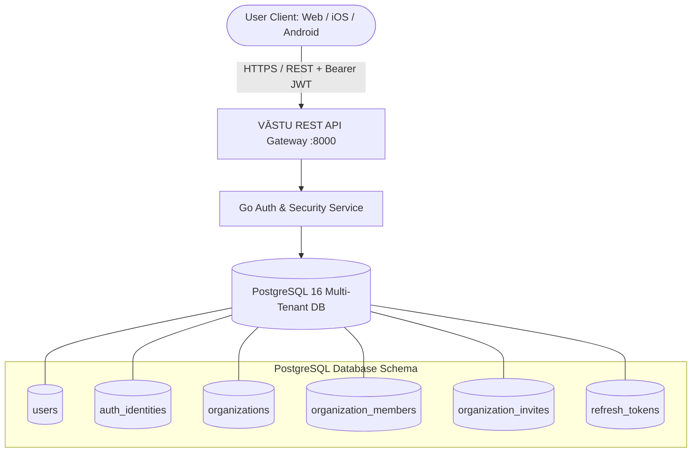
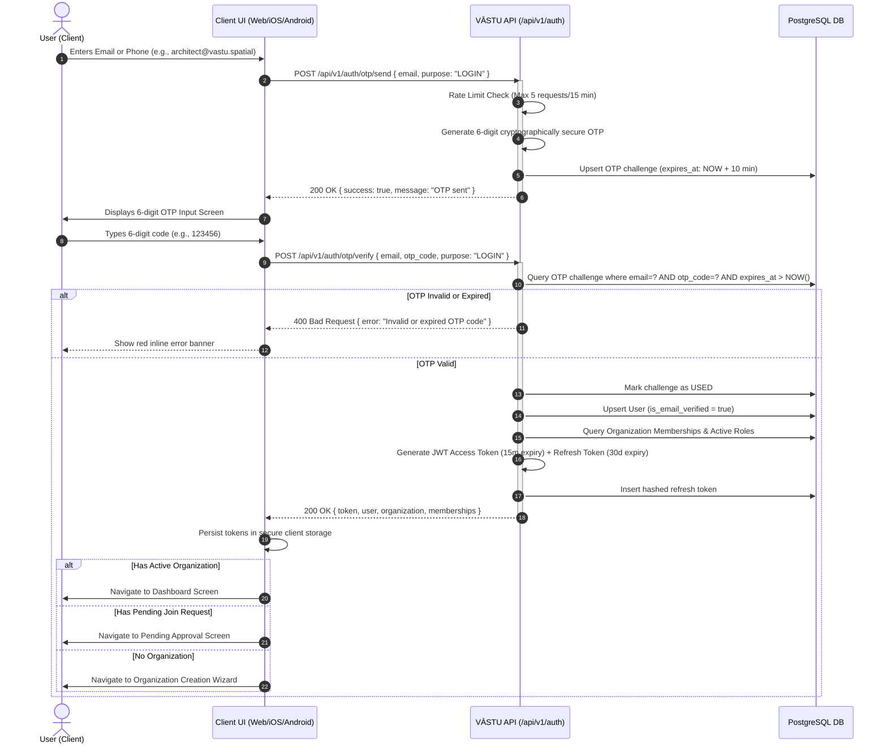
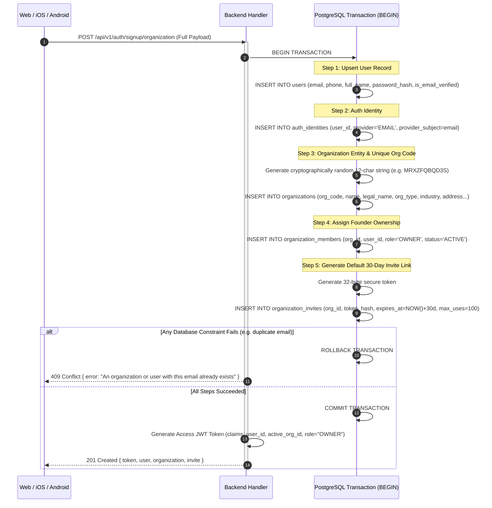
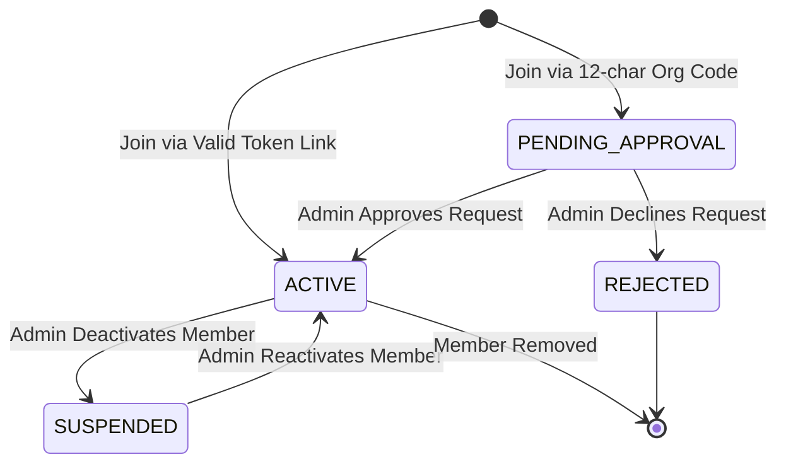
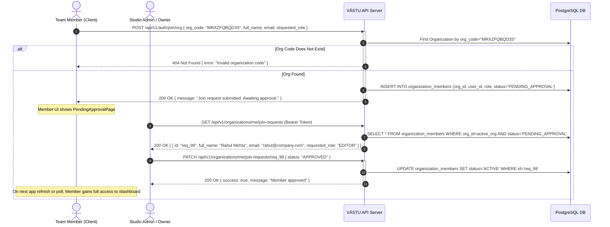
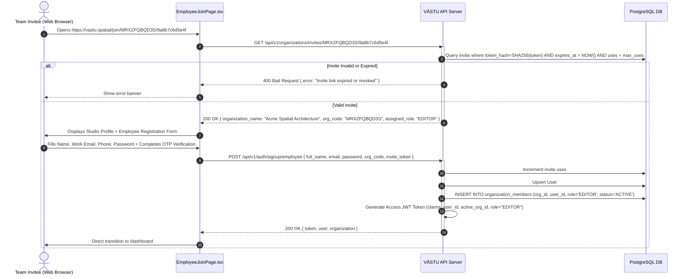

# VĀSTU Spatial: Detailed End-to-End Flow Specification
## Authentication, Registration, Organization Onboarding & Team Membership

---

## 1. System Architecture Overview

VĀSTU Spatial employs a **Multi-Tenant Workspace Model** where every user belongs to one or more organizations or an individual personal workspace.



---

## 2. Detailed Flow 1: Passwordless OTP Login & Registration

Passwordless OTP authentication is the primary login method across mobile and web. It handles both **Sign In** (existing user) and **Instant Sign Up** (new user).

### 2.1 Sequence Diagram



### 2.2 API Specifications & Payloads

#### Step 1: Request OTP
- **Endpoint**: `POST /api/v1/auth/otp/send`
- **Headers**: `Content-Type: application/json`
- **Request Body**:
  ```json
  {
    "email": "architect@company.com",
    "purpose": "login"
  }
  ```
- **Responses**:
  - `200 OK`:
    ```json
    {
      "success": true,
      "message": "Verification code dispatched successfully",
      "data": {
        "email": "architect@company.com"
      }
    }
    ```
  - `429 Too Many Requests`:
    ```json
    {
      "success": false,
      "error": "Rate limit exceeded. Please wait 2 minutes before requesting a new OTP."
    }
    ```

#### Step 2: Verify OTP
- **Endpoint**: `POST /api/v1/auth/otp/verify`
- **Headers**: `Content-Type: application/json`
- **Request Body**:
  ```json
  {
    "email": "architect@company.com",
    "otp_code": "123456",
    "purpose": "login"
  }
  ```
- **Responses**:
  - `200 OK`:
    ```json
    {
      "success": true,
      "data": {
        "token": "eyJhbGciOiJIUzI1NiIsInR5cCI6IkpXVCJ9...",
        "user": {
          "id": "7b8f9e12-4567-890a-bcde-f1234567890a",
          "email": "architect@company.com",
          "phone": "+918208363287",
          "full_name": "Mayank Bajaj",
          "is_email_verified": true,
          "created_at": "2026-09-08T10:00:00Z"
        },
        "organization": {
          "id": "e2a14bc0-1234-5678-90ab-cdef12345678",
          "org_code": "MRXZFQBQD3S",
          "name": "Acme Spatial Studio",
          "legal_name": "Acme Spatial Studio Pvt Ltd",
          "status": "active"
        },
        "memberships": [
          {
            "id": "mem_01",
            "org_id": "e2a14bc0-1234-5678-90ab-cdef12345678",
            "role": "OWNER",
            "status": "ACTIVE"
          }
        ]
      }
    }
    ```
  - `400 Bad Request`:
    ```json
    {
      "success": false,
      "error": "Invalid verification code. 2 attempts remaining."
    }
    ```

---

## 3. Detailed Flow 2: Organization Founder Onboarding (Enterprise Studio)

When an enterprise studio founder registers their company, the backend executes an **Atomic Database Transaction** (`CreateOrganizationAtomic`).

### 3.1 Step-by-Step Onboarding Wizard

```
┌────────────────────────────────────────────────────────────────────────┐
│                        Founder Onboarding Wizard                       │
├────────────────────────────────────────────────────────────────────────┤
│ Step 1: Founder Credentials (Name, Email, Phone, Password, Email OTP)   │
│ Step 2: Studio Information (Name, Legal Name, Industry, Org Type, Size)│
│ Step 3: Business Identifiers & Tax Documents (GSTIN, Registration Doc) │
│ Step 4: Studio Physical Address (Line 1 & 2, City, State, PIN, Country)│
│ Step 5: Atomic Submission & Processing Animation                       │
│ Step 6: Studio Created (Displays 12-char Org Code, WhatsApp Invite)    │
└────────────────────────────────────────────────────────────────────────┘
```

### 3.2 Backend Atomic Transaction Execution



### 3.3 Founder Registration Request Payload

```json
{
  "applicant_name": "Mayank Bajaj",
  "email": "mayank@vastu.spatial",
  "phone": "+918208363287",
  "password": "SecurePassword123!",
  "organization_name": "Acme Spatial Architecture",
  "legal_name": "Acme Spatial Architecture Pvt Ltd",
  "organization_type": "Architecture",
  "industry": "Commercial & Residential Spatial Design",
  "official_email": "contact@acmespatial.com",
  "official_phone": "+918208363287",
  "website": "https://acmespatial.com",
  "number_of_employees": "11-50",
  "year_established": 2024,
  "description": "BIM and 3D Gaussian Splatting Spatial Capture Studio",
  "identifier_type": "GSTIN",
  "identifier_value": "29AAAAA0000A1Z5",
  "address_line1": "100 Outer Ring Road, Tech Corridor",
  "address_line2": "Suite 400",
  "locality": "Bellandur",
  "city": "Bengaluru",
  "state": "Karnataka",
  "pincode": "560103",
  "country": "India"
}
```

### 3.4 Founder Registration Response Payload (`201 Created`)

```json
{
  "success": true,
  "message": "Organization created and founder registered successfully",
  "data": {
    "token": "eyJhbGciOiJIUzI1NiIsInR5cCI6IkpXVCJ9...",
    "user": {
      "id": "d821e2a0-4567-890a-bcde-f1234567890a",
      "email": "mayank@vastu.spatial",
      "full_name": "Mayank Bajaj",
      "phone": "+918208363287"
    },
    "organization": {
      "id": "b9f1a234-1234-5678-90ab-cdef12345678",
      "org_code": "MRXZFQBQD3S",
      "name": "Acme Spatial Architecture",
      "legal_name": "Acme Spatial Architecture Pvt Ltd",
      "status": "active"
    },
    "invite": {
      "invite_url": "https://vastu.spatial/join/MRXZFQBQD3S/9a8b7c6d5e4f",
      "whatsapp_message": "Join Acme Spatial Architecture on VĀSTU Spatial: https://vastu.spatial/join/MRXZFQBQD3S/9a8b7c6d5e4f"
    }
  }
}
```

---

## 4. Detailed Flow 3: Team Member Join & Approval

Team members join an existing organization via two paths.

### 4.1 State Machine for Member Status



---

### 4.2 Path A: Join via 12-Character Organization Code



---

### 4.3 Path B: Join via Tokenized Public Invite Link



---

## 5. Role-Based Access Control (RBAC) Matrix

| Permission / Action | `OWNER` | `ADMIN` | `EDITOR` | `VIEWER` |
| :--- | :---: | :---: | :---: | :---: |
| **Delete Organization** | ✅ | ❌ | ❌ | ❌ |
| **Manage Billing & GSTIN** | ✅ | ✅ | ❌ | ❌ |
| **Approve Join Requests** | ✅ | ✅ | ❌ | ❌ |
| **Generate Invite Links** | ✅ | ✅ | ❌ | ❌ |
| **Change Member Roles** | ✅ | ✅ | ❌ | ❌ |
| **Create 3D Spatial Projects** | ✅ | ✅ | ✅ | ❌ |
| **Upload LiDAR & Video Captures** | ✅ | ✅ | ✅ | ❌ |
| **Trigger Gaussian Splat Processing**| ✅ | ✅ | ✅ | ❌ |
| **View 3D Digital Twins & Floorplans**| ✅ | ✅ | ✅ | ✅ |
| **Export BIM / USDZ / OBJ Models** | ✅ | ✅ | ✅ | ✅ |

---

## 6. Comprehensive Error Handling & Status Codes

| Error Scenario | HTTP Code | Error JSON Response | Client Remediation |
| :--- | :---: | :--- | :--- |
| **Expired or invalid OTP** | `400` | `{"success": false, "error": "Invalid or expired OTP code"}` | Allow user to re-enter or tap "Resend OTP" |
| **OTP Rate Limit Exceeded**| `429` | `{"success": false, "error": "Too many requests. Please wait 2 minutes."}` | Disable send button with countdown timer |
| **Duplicate Organization Name / Email** | `409` | `{"success": false, "error": "Organization or work email already registered"}` | Prompt user to log in instead of creating a new org |
| **Invalid GSTIN Format** | `400` | `{"success": false, "error": "Invalid GSTIN. Expected 15 characters"}` | Pre-validate via regex `^[0-9]{2}[A-Z]{5}[0-9]{4}[A-Z]{1}[1-9A-Z]{1}Z[0-9A-Z]{1}$` |
| **Invalid Org Code** | `404` | `{"success": false, "error": "No organization found with code MRXZFQBQD3S"}` | Prompt user to re-check the 12-char code with their studio lead |
| **Expired Invite Link** | `410` | `{"success": false, "error": "This invitation link has expired"}` | Prompt user to request a fresh invite link from their admin |
| **Expired JWT Token** | `401` | `{"success": false, "error": "Token expired"}` | Transparently call `/api/v1/auth/token/refresh` |
