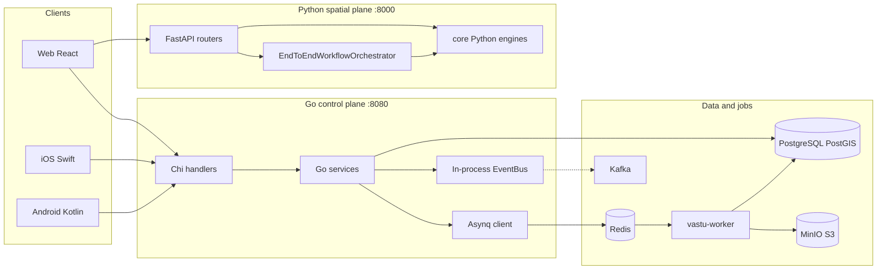
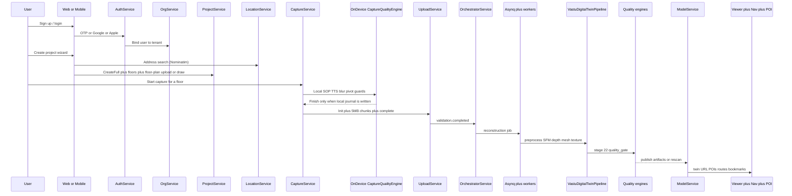

# VĀSTU Spatial — Service-to-Service Architecture

**Document type**: Canonical map of every runtime plane, service, and why it exists  
**Status**: Aligned to the code in this repository  
**Full technical handoff (constants, schemas, gates, protocols):** [TECHNICAL_SYSTEM_MANUAL.md](./TECHNICAL_SYSTEM_MANUAL.md)  
**Related**: [BACKEND_SERVICE_INVENTORY.md](./BACKEND_SERVICE_INVENTORY.md), [API_INVENTORY.md](./API_INVENTORY.md), [floorplan_edge_ai_supervisor_architecture.md](./floorplan_edge_ai_supervisor_architecture.md)

This document is the product path as the system is actually built: who talks to whom, over which port or queue, and **why that hop exists**. It is not a marketing overlay. Where two stacks still run in parallel, that is stated plainly.

---

## 1. Why the platform is split this way

A digital twin product has two kinds of work:

| Kind of work | Constraint | Chosen plane |
|---|---|---|
| Tenancy, identity, project records, chunked video uploads, indoor graph CRUD | Fast HTTP, strong Postgres transactions, JWT, RBAC | **Go control plane** `:8080` |
| Geometry, depth, mesh, quality, AR localize, 22-stage workflow | NumPy/Open3D/PyTorch, long jobs, in-process scientific code | **Python spatial plane** `:8000` + **worker container** |
| Live capture quality | Must not wait on the network in basements | **On-device** iOS / Android |
| Operator dashboard, floorplan canvas, 3D viewer | Browser | **Web app** (Vite/React) |

Go is not used to reconstruct meshes because Open3D and COLMAP-class work live in Python/C++. Python is not used as the tenant source of truth because org membership, OTP, and project lifecycle need a single transactional database the mobile apps already call.

---

## 2. Runtime topology

Compose services from [docker-compose.yml](../docker-compose.yml):

| Compose service | Port | Why it exists |
|---|---|---|
| `vastu-postgres` (PostGIS 16) | 5432 | Single tenant database: users, orgs, projects, floors, floor_plans, captures, uploads, jobs, models, POIs, nav graph, rescans. PostGIS is for indoor/POI distance queries (`ST_DWithin`). |
| `vastu-migrate` | — | Applies SQL in `database/migrations/` so schema matches code. |
| `vastu-redis` | 6379 | Asynq job queue + worker heartbeats. Reconstruction must not run inside the 60s HTTP timeout. |
| `vastu-minio` | 9000 / 9001 | S3-compatible object store for raw captures, artifacts, exports. Large videos must not live only in the API process. |
| `vastu-minio-init` | — | Creates buckets `vastu-raw-captures`, `vastu-artifacts`, `vastu-exports`. |
| `vastu-backend` | **8080** | Go control plane. Clients (web/iOS/Android) use this as the product API. |
| `vastu-api` | **8000** | FastAPI spatial plane. Reconstruction orchestration, quality, AR, search engines in `core/`. |
| `vastu-worker` | — | Python/C++ reconstruction binaries invoked by Asynq handlers or `scripts/generate_video_twin.py`. |
| `asynq-web` | 8081 | Operator UI for Redis/Asynq queues. |
| `vastu-kafka` | 9092 | Optional domain-event bus (`vastu.*` topics). In-process EventBus is what most Go code uses today. |

---

## 3. End-to-end product flow (operator journey)

This is the sequence a real survey uses. Later sections expand each hop.

**Zero-cloud rule (capture only):** while the camera is recording, iOS/Android must not call SOP generation, reconstruction, or quality APIs. Auth/project fetch can happen before Record. Upload starts after the surveyor confirms.

---

## 4. Client planes (who consumes APIs)

### 4.1 Web app (`src/`)

| Client module | File | Why it is used |
|---|---|---|
| `ApiService` | [src/services/api.ts](../src/services/api.ts) | Single HTTP client to Go `:8080` `/api/v1`. Attaches JWT, refreshes tokens, unwraps `{ data }`. |
| `SpatialSOPService` | [src/services/spatialSOPService.ts](../src/services/spatialSOPService.ts) | **Intended** to turn a floorplan + recon frame into zone SOP. Today it calls an external multimodal key (`VITE_SPATIAL_API_KEY`). Product rule: this must become a **pre-capture** Go/Python job that writes `captures.capture_sop`, not a live call during filming. |
| `googleAuth` | [src/services/googleAuth.ts](../src/services/googleAuth.ts) | Browser Google identity; token is verified by `GoogleService` on Go. |
| Project wizard | [src/pages/projects/ProjectCreationWizard.tsx](../src/pages/projects/ProjectCreationWizard.tsx) | Creates tenant project, floors, metric area/height, uploaded PDF/PNG or vector drawing. |
| Guided capture studio | [src/pages/capture/GuidedCaptureStudioPage.tsx](../src/pages/capture/GuidedCaptureStudioPage.tsx) | Web monitor for a phone capture: QR pairing, floor selection, SOP zones. Must **read** stored SOP, not generate it on every tick. |

### 4.2 iOS (`ios/VastuSpatial/`)

| Module | Why it is used |
|---|---|
| `VastuAPIClient` | Product API: auth, org, projects, captures, uploads. Tokens in Keychain. |
| `AVCameraManager` | Records RGB video locally. Used instead of streaming to cloud so a dropped cell does not lose the scan. |
| `MotionSensorManager` + `IMUValidator` | 200 Hz-class IMU log required later for pose/scale. |
| `CaptureQualityEngine` | 11-stage SOP + TTS + blur/overlap/light. Prevents tin-foil meshes **before** upload. |
| `LocalCaptureStorageManager` + `CaptureSessionJournal` + `CaptureRecoveryManager` | Crash-safe local packet so incomplete takes resume. |
| `ResumableUploadManager` | 5 MB chunks matching `UploadService`. Field Wi-Fi dies; chunks retry. |
| `QRScannerView` | Pair phone to a web-assigned capture / project without typing UUIDs. |

### 4.3 Android (`android/app/`)

Same responsibilities as iOS: CameraX, `ImuSensorManager`, `CaptureQualityEngine`, Room/journal, WorkManager `ResumableUploadWorker`, Retrofit `VastuApiService`. Why duplicate: surveyors use mixed fleets; reconstruction contract (video + IMU + manifest) must be identical.

---

## 5. Go control plane services (`backend/internal/service/`)

Wiring: [backend/cmd/server/main.go](../backend/cmd/server/main.go). Handlers never talk to SQL; services own rules; repositories own SQL.

### 5.1 Identity and tenancy

#### OTPService — `otp_service.go`

- **Why**: Email verification without storing passwords in transit. Codes expire in 10 minutes.
- **Calls**: `OTPRepository`, `SMTPMailer`.
- **Called by**: `AuthService`, signup flows.
- **Tables**: `otps`.

#### AuthService — `auth_service.go`

- **Why**: One identity for web + mobile. Issues JWT (`user_id`, `org_id`, `role`) so every later service can tenant-scope without re-checking passwords.
- **Calls**: user/org/member/token/identifier/document/address/invite/join repos, `OTPService`, `GoogleService`, `AppleService`, `TokenManager`.
- **Called by**: `/api/v1/auth/*` handlers.
- **Why Google/Apple exist as separate services**: ID tokens must be verified with Google/Apple keys, not trusted from the client.

#### GoogleService / AppleService

- **Why**: SSO for field staff who will not complete email OTP on a jobsite. Go verifies the token; the client never becomes an identity provider.

#### OrgService — `org_service.go`

- **Why**: Multi-tenant boundary. Projects, captures, and models are meaningless without an org. Handles invite codes, GST/docs, join-request approve/reject, SMTP invites.
- **Tables**: `organizations`, `organization_members`, documents, addresses, invites, join requests.

### 5.2 Project and site setup

#### LocationService — `location_service.go`

- **Why**: Project wizard needs a real site address and lat/lng for later outdoor-to-indoor context. Does **not** store maps in Postgres.
- **Calls**: OpenStreetMap Nominatim (`/locations/search`, `/locations/reverse`).
- **Why not Google Places by default**: avoid billing on every keystroke; Nominatim is enough for India address search in the wizard.

#### ProjectService — `project_service.go`

- **Why**: The digital twin is always owned by a **project** (client, typology, buildings, floors, team, timeline, chat, activity).
- **Does**: `Create` / `CreateProjectFull`, floors CRUD, floor-plan upload (PNG/JPG/PDF) and vector `drawing_data` JSON, cover image, members, timeline, chat, client emails, soft-delete (30-day trash).
- **Tables**: `projects`, `project_floors`, `floor_plans`, `project_members`, timeline, chat, emails, activity.
- **Called by**: web wizard, mobile project list, dashboard.
- **Downstream**: floor plan file is stored under `UPLOAD_DIR` and served at `/uploads/...`. Parser/SOP (target) runs **after** this write, not during camera preview.

Floor-plan HTTP surface (same service):

| Method | Path | Why |
|---|---|---|
| POST | `/projects/{id}/floors/{floorId}/floor-plan/upload` | Attach CAD screenshot / PDF. |
| POST/PATCH | `.../floor-plan/draw` | Interactive vector canvas objects. |
| GET | `.../floor-plan` | Mobile/web sync of the blueprint. |
| DELETE | `.../floor-plan` | Replace a wrong drawing. |

### 5.3 Capture and bytes

#### CaptureService — `capture_service.go`

- **Why**: A capture is the legal/operational record of a survey (device, IMU rate, LiDAR flag, floor, operator, `capture_sop` JSONB, phase). Reconstruction jobs point at a capture, not a raw filename.
- **Tables**: `captures` (including `floor_id`, `capture_sop`, `recon_video_url`, `zone_progress` from migration 000019).
- **Called by**: mobile when a session starts; web studio for monitoring.

#### UploadService — `upload_service.go`

- **Why**: Phone videos are hundreds of MB. A single POST dies on 4G. 5 MB chunks + SHA-256 + complete/quarantine exist so:
  1. retries are cheap,
  2. malware/mime checks run before a worker opens the file,
  3. capture status can move to `uploaded`.
- **Calls**: `UploadRepository`, `CaptureRepository`, `UploadSecurityValidator`.
- **HTTP**: `POST /uploads/init`, chunk PUT/POST, progress, complete.
- **After complete**: in-process event `validation.completed` is the intended trigger for reconstruction (see OrchestratorService).

#### RescanService — `rescan_service.go`

- **Why**: Quality FAIL must not mean “reshoot the whole building.” A rescan is a **localized** card: area name, XYZ target, radius, mobile instruction.
- **Tables**: `rescan_requests`.
- **Called by**: quality decision (target) and `/rescan-requests` API; mobile lists pending cards.

### 5.4 Jobs, models, delivery

#### JobService — `job_service.go`

- **Why**: HTTP clients poll progress. Workers update `processing_jobs` stage + percent + logs. Decouples UI from Python runtime.
- **Tables**: `processing_jobs`, job logs.

#### OrchestratorService — `orchestrator_service.go`

- **Why**: Glue between “upload is clean” and “start reconstruction.” Subscribes to `validation.completed`, spawns a job, tracks worker heartbeats and retries (max 3).
- **Calls**: Job / Capture / Model repos, EventBus, (intended) Asynq enqueue.
- **Why not do this in UploadService**: upload must stay a storage concern; orchestration retries and heartbeats are a different failure domain.

#### ModelService — `model_service.go`

- **Why**: Immutable-ish registry of published twins (version, LOD artifacts: mesh, atlas, viewer HTML). Apps never point at a worker temp folder.
- **Tables**: `models`, `model_artifacts`.

#### POIService — `poi_service.go`

- **Why**: Digital twin is not only geometry. Named indoor points (x, y, z, floor) are what search and navigation hang on.
- **Tables**: `spatial_pois`.

#### SearchService — `search_service.go`

- **Why**: “Find the kitchen” is text + spatial. Uses POI repo / PostGIS distance, not a full mesh query (too slow for typeahead).

#### NavigationService — `navigation_service.go`

- **Why**: Indoor wayfinding on the published graph (nodes/edges), Dijkstra/A*, wheelchair flags. Must not raycast the triangle mesh at request time.
- **Tables**: `navigation_nodes`, `navigation_edges`.
- **Reads**: POIs as start/end hints.

#### ViewerService — `viewer_service.go`

- **Why**: Bookmarks and annotations are user state on a twin, not part of the mesh file. Lets two operators share a camera pose without editing geometry.

---

## 6. Go supporting packages (not “services” but on the call path)

| Package | Why |
|---|---|
| `pkg/jwt` | Access/refresh tokens. Stateless auth for mobile. |
| `pkg/mailer` | OTP and org invites. |
| `pkg/security` | Upload quarantine / MIME. Workers must not ingest untrusted blobs. |
| `pkg/events` | In-process pub/sub (`capture.created`, `upload.completed`, `quality.failed`, …). Kafka producer/consumer exist for the same topic names when a bus is required across containers. |
| `pkg/queue` | Asynq task types: preprocess → SFM → depth → fuse → mesh → texture → semantics → QA → finalize. Each handler shells a Python worker then **chains** the next task so Redis, not HTTP, owns the long pipeline. |

Asynq task chain (why this order):

1. **preprocess_video** — drop blur/dark frames; IMU interpolate. Bad frames destroy SFM.
2. **run_sfm** — poses. Everything metric after this depends on camera motion.
3. **run_depth_estimation** — per-keyframe depth on those poses.
4. **fuse_point_cloud** — multi-view consensus; rejects single-view noise (tin foil).
5. **run_mesh_reconstruction** — surfaces for the viewer.
6. **run_texturing** — photographic atlas from original RGB (photorealism).
7. **run_semantic_segmentation** — walls vs clutter so floors are not “sneaker lumps.”
8. **run_quality_assurance** — gate before publish.
9. **finalize_model** — register artifacts in ModelService / MinIO.

---

## 7. Python spatial plane (`api/` + `core/`)

FastAPI [api/main.py](../api/main.py) on `:8000`. Used when the caller needs reconstruction/quality/AR engines **in process**, or the 22-stage orchestrator.

### 7.1 Routers and why each exists

| Router | Prefix | Why |
|---|---|---|
| `auth` | `/auth` | Lightweight token check so Python can run without always proxying Go (test/orchestrator). Product auth of record is still Go JWT. |
| `projects` / `spaces` | `/projects`, `/spaces` | Spatial “space” records for cells/models when not going through Go. |
| `captures` | `/captures` | Manifest ingestion from Python packaging. |
| `uploads` | `/uploads` | Presigned part URLs via `storage/` adapters (local or S3/MinIO). Complements Go chunk API for worker-side storage. |
| `jobs` | `/jobs` | Starts `EndToEndWorkflowOrchestrator` (`POST /jobs/orchestrated`). Progress 0–100% per `WorkflowStage`. |
| `models` | `/models` | Python-side model registry (`ImmutableModelRegistry`) for version compare. |
| `quality` | `/quality` | Submit/read quality reports; drives rescan payload. |
| `rescans` | `/rescans` | Targeted patch captures. |
| `pois` / `search` / `navigation` | matching | Same product features as Go, implemented with `core/poi`, `core/search`, `core/navigation` for engine-accurate graphs (A* on generated nav mesh). |
| `ar` | `/ar` | Relocalize a live camera into the twin (markers + PnP). Needed for on-site AR overlays after the twin exists. |
| `infrastructure` | `/infrastructure` | Health/deps for the spatial plane. |
| `websocket` | `/ws` | Push job progress to the web studio without polling. |

### 7.2 `core/` engines — why each module exists

Grouped by the stage that needs them.

**Capture (phone logic mirrored in Python for tests and orchestrator):**

| Module | Why |
|---|---|
| `core/sop/sop_engine.py` | Same 11 SOP stages as mobile, so cloud tests and TTS scripts stay in lockstep with the app. |
| `core/sop/signals.py`, `tts_engine.py` | Live quality signals and speech priority (critical > warning > guidance). |
| `core/capture/*` | Ring buffer, journal, recovery, storage monitor, 5 MB upload queue — reference implementation of what iOS/Android must do. |
| `core/validation/capture_validator.py` | Rejects a package before SFM (missing IMU, inverted timestamps). |

**Ingest and pose:**

| Module | Why |
|---|---|
| `core/preprocessing/*` | Blur, exposure, 4×4 feature coverage, keyframe pick. Reduces GPU cost and SFM failure. |
| `core/tracking/*` | Relative pose + parallax. Detects “pivot in place” which bows walls. |
| `core/alignment/*` | Metric scale: LiDAR > physical tape > **floorplan dimensions** > object size > manual. Floorplan evidence exists so a drawing with known meters can scale a monocular twin. |

**Geometry:**

| Module | Why |
|---|---|
| `core/dense/*` | Multi-view depth consistency + voxel fusion. Consensus ≥ 2 views (no invented geometry). |
| `core/spatial/*` | Split large sites into cells so one failed room does not kill the building. |
| `core/structure/*` | Walls, openings, graph of rooms. |
| `core/correction/*` | Snap/clip/prune/thickness — architectural priors that a raw Poisson mesh does not have. This is the **code form** of “supervisor commands” (smoother walls, sealed floor, clip envelope). |
| `core/semantics/*` | Clutter vs structure so curtains are not flattened and shoes are not meshed as floor tumors. |
| `core/texturing/*` | Atlas + delighting for unobserved patches. |

**Ship and live in the twin:**

| Module | Why |
|---|---|
| `core/quality/*` | Weighted capture/pose/depth/geometry/semantics/navigation score + rescan generator + decision narrative. |
| `core/versioning/*` | Immutable versions and rescan merge. |
| `core/navigation/*` | Build nav graph from floors/obstacles; A* planner. |
| `core/poi`, `core/search` | Same as Go product features, engine-side. |
| `core/ar/*` | Marker detect + localize so the phone can overlay routes on the published twin. |
| `core/orchestrator/workflow_engine.py` | Runs the 22 `WorkflowStage` sequence (mobile → SOP → upload → ingest → … → web viewer) for automated tests and `/jobs/orchestrated`. |
| `core/testing/failure_injector.py` | Proves each stage fails closed (corrupt video, tracking loss, GPU OOM). |

### 7.3 22-stage orchestrator vs 25-stage twin vs Asynq

Three pipelines exist. They are **the same product idea** at different completeness levels:

| Pipeline | Entry | Why it exists |
|---|---|---|
| Asynq + `backend/workers/*` | Redis after upload | Production-shaped **job chain** with Postgres progress. |
| `scripts/generate_video_twin.py` (stages 00–24) | CLI / `v3_reconstruction_engine.py` | Evidence-driven twin with artifacts under `digital_twin_output/` (keyframes, poses, depth, mesh, texture, reprojection, quality, recovery, provenance). |
| `EndToEndWorkflowOrchestrator` | FastAPI `/jobs/orchestrated` | Contract/test path covering SOP through viewer, including injected failures. |

Target architecture: upload complete → OrchestratorService → Asynq → **v3 twin engine** (25 stages) → quality → ModelService. FastAPI orchestrator remains for spatial-engine features (AR, hybrid search) and CI.

---

## 8. Reconstruction workers (`backend/workers/` + `scripts/`)

| Worker | Why |
|---|---|
| `preprocessing/video_preprocessor.py` | Frame quality + IMU sync. |
| `tracking/camera_tracker.py` | 6-DoF from video. |
| `sfm/sfm_pipeline.py` | Sparse reconstruct / BA. |
| `depth/depth_estimator.py` | Neural depth + MAD scale alignment. |
| `pointcloud/dense_pointcloud_engine.py` | Dense cloud, outlier reject. |
| `meshing/mesh_reconstruction_engine.py` | Mesh from consensus points. |
| `texturing/texture_reconstruction_engine.py` | Multi-view bake. |
| `semantics/semantic_understanding_engine.py` | Structure vs clutter. |
| `spatial/spatial_cell_engine.py` | Per-cell reconstruct. |
| `spatial/global_spatial_fusion_engine.py` | Stitch cells. |
| `spatial/incremental_update_engine.py` | Merge a micro-rescan without full rebuild. |
| `quality/quality_engine.py` | Worker-side gate. |
| `rescan/targeted_rescan_manager.py` | Apply a patch capture. |
| `pipeline/v3_reconstruction_engine.py` | Thin wrapper: `VastuDigitalTwinPipeline.run()`. |

**Cloud AI Supervisor (target, not a separate microservice):** after mesh + reprojection inside `generate_video_twin.py`, compare mesh vs keyframes vs floorplan polygons, write `23_recovery/recovery_log.json`, re-run stage 11/14/17 with targeted knobs (Taubin iterations, floor plane Y=0, clip Z, disable aggressive cluster prune). Why in-process: the mesh is already in memory; an extra HTTP supervisor would copy gigabytes for no gain.

---

## 9. Service-to-service call matrix

Who is allowed to call whom (intended product wiring):

| From | To | Trigger | Why |
|---|---|---|---|
| Web / iOS / Android | AuthService | Login | Establish tenant JWT. |
| Clients | OrgService | Invite / join | Put user in a company. |
| Clients | LocationService | Wizard address | Fill site lat/lng. |
| Clients | ProjectService | CRUD project + floor plan | Blueprint ground truth. |
| ProjectService | disk `/uploads` | Plan file | Serve preview URLs. |
| Clients | CaptureService | Start survey | Bind device session to floor. |
| CaptureQualityEngine | (none) | During Record | Zero cloud buffering. |
| Clients | UploadService | After confirm | Move packet off device. |
| UploadService | EventBus | complete + validate | Start jobs without blocking HTTP. |
| EventBus | OrchestratorService | `validation.completed` | Spawn reconstruction. |
| OrchestratorService | JobService + Asynq | new job | Durable progress + worker. |
| Asynq handlers | Python workers | each stage | Heavy compute. |
| Workers | MinIO | artifacts | Persist PLY/OBJ/atlas. |
| Workers | JobService (progress HTTP or SQL) | stage ticks | UI polling. |
| Twin pipeline | CentralQualityEngine / stage 22 | after texture | Pass/fail. |
| Quality FAIL | RescanService | localized defect | Phone card, not full reshoot. |
| Quality PASS | ModelService | publish | Apps load a versioned URL. |
| Web viewer | Model + Viewer + POI + Nav + Search | roam | Use twin, not raw video. |
| Phone (post-twin) | FastAPI `/ar/localize` | on site | Align live camera to mesh. |

Forbidden during recording: CaptureQualityEngine → SpatialSOPService cloud, CaptureQualityEngine → jobs/quality APIs.

---

## 10. Data stores — why each table family exists

| Tables | Owning service | Why |
|---|---|---|
| `users`, `otps`, tokens | Auth | Identity. |
| `organizations`, members, invites | Org | Tenant. |
| `projects`, floors, `floor_plans` | Project | Site + blueprint. |
| `captures` | Capture | Survey packet metadata + SOP JSON. |
| upload sessions | Upload | Chunk state. |
| `processing_jobs` | Job / Orchestrator | Reconstruction UX. |
| `models`, artifacts | Model | Published twin. |
| `spatial_pois` | POI / Search | Indoor labels. |
| `navigation_nodes/edges` | Navigation | Walkable graph. |
| viewer bookmarks | Viewer | Shared viewpoints. |
| `rescan_requests` | Rescan | Micro-heal. |

Object storage keys (MinIO): raw video/IMU in `vastu-raw-captures`; meshes/atlas in `vastu-artifacts`; ZIP exports in `vastu-exports`. Postgres stores URLs and hashes, not the mesh bytes.

---

## 11. On-device services (detailed)

These are **services** in the product sense even though they are not HTTP.

| On-device service | Inputs | Outputs | Why |
|---|---|---|---|
| Camera | Sensor | MP4 | Photometric evidence for texture and SFM. |
| IMU | Gyro/accel | CSV/JSON timed with video | Rotation vs translation; pivot detection. |
| CaptureQualityEngine | Video + IMU + (target) `capture_sop` | TTS, HUD, SOP stage index | Stops degenerate motion and incomplete coverage. |
| Storage monitor | Disk | Block record if full | A truncated file poisons the worker. |
| Journal / recovery | Session dir | Resume offset | App kill mid-scan. |
| Upload manager | Finished packet | Chunks to UploadService | Only **after** local confirm. |

Hardcoded SOP stages (must later be **overlaid** with floorplan zones): Room Entry → Perimeter → Walls → Corners → Doorway → Windows → Floor → Ceiling → Center → Loop closure → Completion. Floor/ceiling stages exist because missing floor pixels become holes in stage 14 mesh.

---

## 12. Honest gaps (so this document stays true)

| Claim | Code today |
|---|---|
| Floorplan parsed into metric wall graph | Plans are stored (`floor_plans.drawing_data` / file). No vectorization worker yet. `FloorplanDimensionEvidence` is tested but not filled from `ProjectService`. |
| `captures.capture_sop` from blueprint | Column exists. Mobile engines still use a **fixed** 11-step list. Web SOP may call an external vision API. |
| CoreML / TFLite 60 FPS | Not in the apps. Quality is classical (blur, IMU, overlap heuristics). |
| ARKit/ARCore pose locked to floorplan | Profile mentions AR; capture path is AVFoundation/CameraX. |
| Orchestrator always enqueues Asynq | Event subscription is written; production `main.go` currently constructs JobService without always attaching Asynq/Orchestrator in the same process. Wire this when enabling workers in compose. |
| FastAPI quality store | Some routers use in-memory dicts for tests; Go `rescan_requests` is the durable card. |
| Supervisor retry loop | Stage 22 is one-shot scoring; `RecoveryController` logs adaptations; `ArchitecturalGeometryCorrector` is the correction toolkit to loop. |

---

## 13. How to read this with other docs

- **This file**: every service, every hop, why.
- [floorplan_edge_ai_supervisor_architecture.md](./floorplan_edge_ai_supervisor_architecture.md): same hops, product narrative (blueprint → offline co-pilot → supervisor).
- [BACKEND_API_REQUEST_RESPONSE.md](./BACKEND_API_REQUEST_RESPONSE.md): HTTP bodies.
- [TECHNOLOGY_TRUTH_TABLE.md](./TECHNOLOGY_TRUTH_TABLE.md): what is actually on disk vs claimed.

When adding a feature, add a row to **Section 9** first (who calls whom and why), then the code. Do not add a fourth reconstruction pipeline.
