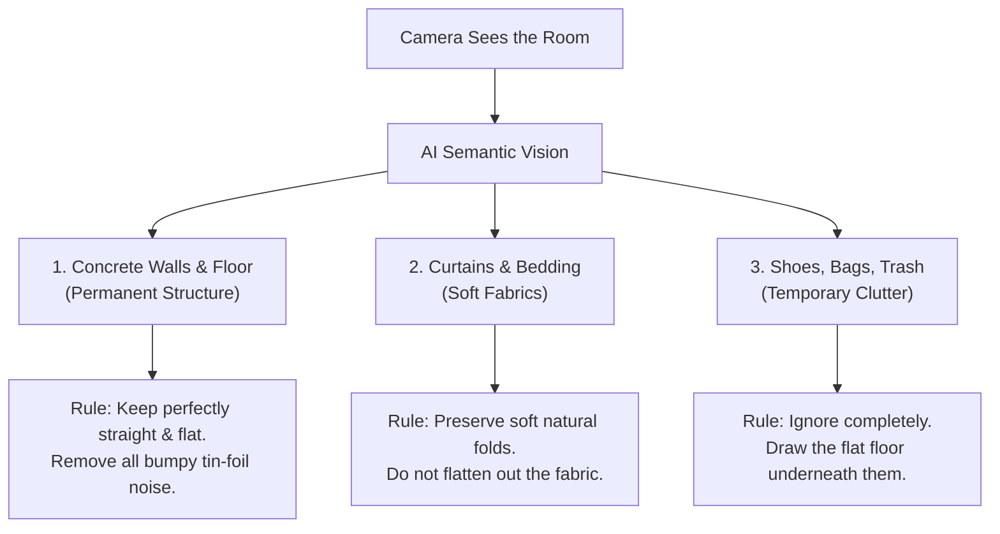
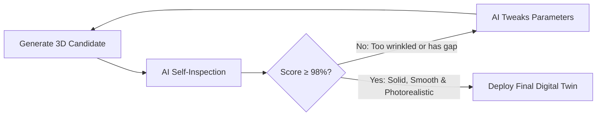

# VĀSTU Spatial — Simplified End-to-End Guide: AI Capture, Object Understanding & Self-Improvisation

**Document Type**: Concept & Product Architecture Guide  
**Target Audience**: Developers, Product Managers, Field Surveyors, Stakeholders  
**Status**: Approved Specification  

---

## The Core Idea in One Sentence

Instead of treating the phone camera as a dumb video recorder, **the app acts as an expert 3D surveyor living inside the phone**—it watches what you film in real time, understands the objects in the room, guides your hands to prevent mistakes, and self-corrects the 3D model through internal trial-and-error until the final twin is clean and solid.

---

## 1. What Happens When You Capture (The Live AI Co-Pilot)

When a surveyor opens the app camera, they are not looking at a normal video feed. They are looking through an **interactive Augmented Reality (AR) game**:

```
 ┌────────────────────────────────────────────────────────┐
 │  [LIVE CAMERA SCREEN]                         82% Done │
 │                                                        │
 │     [GREEN BLOCKS]         [YELLOW BLOCKS]             │
 │     (Left Wall: Solid)     (Doorway: Need more angle)  │
 │                                                        │
 │                    [RED BLOCKS]                        │
 │                    (Floor: Not captured yet!)          │
 │                                                        │
 │   ⚠️ "Take small steps sideways — do not pivot in place"│
 │                                                        │
 └────────────────────────────────────────────────────────┘
```

### 1.1 "Paint the Room Green" (Live Voxel Heatmap)
* **The Problem**: People naturally point the camera at eye-level walls and completely forget the floor and ceiling. This is why earlier models had a giant hole in the center of the floor!
* **The AI Fix**:
  * As you walk around, the AI paints see-through 3D blocks over the room.
  * **Red Blocks**: You haven't looked here yet.
  * **Yellow Blocks**: You looked quickly, but the AI needs one more angle.
  * **Green Blocks**: Fully captured and locked in.
  * You cannot accidentally hit *"Finish"* while there are red blocks on the floor.

### 1.2 The "Don't Stand in Place" Coach (Parallax Baseline)
* **The Problem**: If you stand in one spot and twist your wrist like a tripod, standard 3D algorithms fail completely because they cannot calculate true depth without sideways movement.
* **The AI Fix**:
  * The phone's motion sensors measure your physical steps.
  * If you twist your wrist without moving your feet, a gentle voice and screen banner prompts:
    > *"Take small sideways steps along the floor — walk like you're carrying a tray of water."*

### 1.3 The Speed & Blur Guard
* If you swing the phone too fast, video turns blurry. The AI flashes an orange prompt:
  > *"Slow down — moving too fast."*

---

## 2. Object Understanding: How the AI Knows What It Sees

Standard 3D software treats every pixel as an identical dot. **VĀSTU AI recognizes the real-world identity and material of every item in the room:**



### 2.1 Concrete Walls vs. Fabric Curtains
* **Concrete Walls**: A wall is flat. If the camera depth sensor has slight noise, standard tools turn the wall into wrinkled aluminum foil. The AI says: *"I know this is a wall; smooth out all micro-ripples and snap it to a straight vertical plane."*
* **Curtains**: Curtains naturally have wavy folds. The AI recognizes fabric and says: *"This is a curtain; do NOT flatten it out. Preserve the natural folds and full recessed depth."*

### 2.2 Permanent Structure vs. Temporary Clutter
* If someone left a backpack or sneakers on the floor, standard tools create awkward 3D lumps on the ground.
* The AI identifies the sneakers as movable objects, ignores them during meshing, and keeps the room floor smooth, flat, and continuous.

---

## 3. How the AI "Improvises" and Self-Corrects

The AI never just runs once and accepts a broken output. It **evaluates its own work in a feedback loop**:

### 3.1 Live Improvisation (While You Are Still in the Room)
* As you approach the doorway, the AI asks itself: *"Do I have enough visual angles of the curtain recess?"*
* If the recess is shadowed or partially hidden, an AR arrow points on screen:
  > *"Take 2 steps left and tilt down to capture the door threshold."*
* You fix it in 3 seconds before ever leaving the site.

### 3.2 Cloud Self-Tuning Loop (Iterating Until Perfect)
Once the video uploads to the cloud, the internal optimizer runs a self-testing loop:



1. **Trial 1**: The engine generates an initial 3D mesh.
2. **AI Inspection**:
   * *"Is the floor 100% solid? Yes."*
   * *"Are the walls wrinkled like foil? Yes, normal variance is too high."*
3. **Improvise & Adjust**:
   * The AI increases volume-preserving Taubin smoothing, widens the normal search radius from 8cm to 12cm, and enables smooth linear interpolation.
4. **Trial 2**: Inspects again.
   * *"Are the walls smooth and straight? Yes."*
   * *"Do the reprojected colors match the raw video frames? 99.2% match."*
5. **Done**: The twin is exported with flawless geometry and deployed to the web viewer.

### 3.3 Targeted Micro-Rescans (Self-Healing Without Redoing)
* If an area was completely blocked (e.g., someone was standing in front of a closet during capture), the AI does **not** ask you to re-record the entire building.
* Instead, the surveyor gets a notification card on their phone:
  > *"Overall twin is 94% complete. Quick 5-second scan needed for the closet door from 1.5m away."*
* The surveyor points at that one spot for 5 seconds. The AI merges the new patch directly into the existing 3D model.

---

## 4. Summary: Traditional Method vs. VĀSTU AI Journey

| Challenge | Traditional Capture (No AI) | VĀSTU AI-Optimized Journey |
| :--- | :--- | :--- |
| **How You Film** | Blind recording. You hope you got everything. | **AR game overlay**: Live green/yellow/red blocks tell you exactly where to aim. |
| **Pivoting Mistakes** | Panning in place bows walls into curved bowls. | **Real-time motion sensor warnings**: Prompts you to step sideways. |
| **Floor Surface** | Sparser floor points create a giant hole in the floor center. | **AI understands floor structure**: Enforces a 100% continuous flat floor. |
| **Wall Texture** | High-frequency depth noise causes wrinkled tin-foil look. | **Semantic smoothing**: Walls are smooth and straight; curtains retain folds. |
| **Surface Shading** | Default shiny specular reflections look like chrome foil. | **Architectural PBR materials**: Realistic, warm, matte plaster and cloth. |
| **When Things Go Wrong** | Whole capture fails; you must drive back and re-record everything. | **Caught live in AR** or fixed via a 5-second micro-rescan card. |

---

## 5. Next Steps for Development

1. **Step 1 (Engine Level — Completed)**:
   - Fixed continuous floor plane preservation (`is_floor_tri`).
   - Replaced noisy normals with smooth linear Poisson meshing and volume-preserving Taubin smoothing.
   - Converted web viewer to diffuse architectural PBR standard materials (`roughness: 0.82`, `metalness: 0.05`).
2. **Step 2 (Mobile App Level — Up Next)**:
   - Implement the ARKit/ARCore translation baseline tracker in the iOS and Android apps.
   - Add the live voxel coverage overlay (Red $\rightarrow$ Green) to guide the surveyor during recording.
3. **Step 3 (Micro-Rescan Level)**:
   - Connect the backend quality auditor to the mobile app's push notification queue to request 5-second localized patches when occlusions occur.
