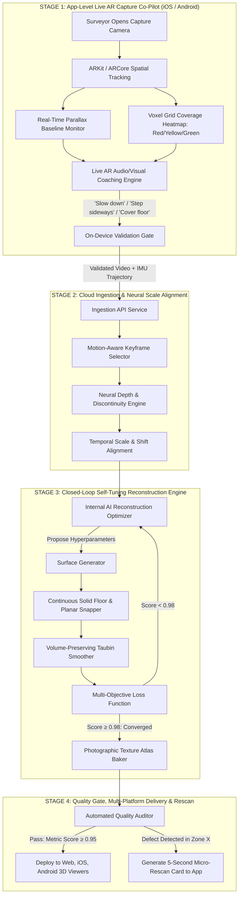

# VĀSTU Spatial — End-to-End AI-Optimized Journey: App-Level Capture to 3D Digital Twin

**Document Version**: 1.0.0  
**Status**: Architecture & Technical Specification  
**Scope**: iOS / Android Mobile Apps, Go Backend Services, Python 3D Reconstruction Engine, WebGL Viewer  

---

## Executive Summary

Reconstructing photorealistic, metric-accurate 3D digital twins from casual smartphone video is fundamentally constrained by input quality. When users record video by pivoting in place, moving too fast, or overlooking the floor and structural recesses, downstream reconstruction engines fail with:
1. **Crumpled tin-foil surfaces** (depth estimation noise and wild surface normal fluctuations).
2. **Hollow cutouts and floor gaps** (sparse or missing point cloud consensus in un-aimed regions).
3. **Warped architectural planes** (insufficient camera translation baseline causing monocular depth to bow flat walls).

This specification defines the **End-to-End AI-Optimized Spatial Journey**, replacing brittle static pipelines with an **Active Multi-Stage AI Loop**:
- **At App Level**: Real-time AR guidance with live voxel coverage heatmaps, translation baseline tracking, and speed guards that prevent bad data before upload.
- **At Engine Level**: A **Closed-Loop Self-Tuning Optimizer** that evaluates candidate meshes against an automated multi-objective loss function ($\mathcal{L}_{\text{reproj}} + \mathcal{L}_{\text{chamfer}} + \mathcal{L}_{\text{planarity}} + \mathcal{L}_{\text{floor}}$), iteratively refining hyperparameters until the model achieves $\ge 0.98$ quality.
- **At Delivery Level**: A self-auditing quality gate that triggers targeted 5-second micro-rescan prompts if localized occlusions remain.

---

## 1. System Architecture & End-to-End Data Flow



---

## 2. Stage-by-Stage Technical Specifications

### Stage 1: App-Level Real-Time AR Capture Co-Pilot

> [!IMPORTANT]
> Over 85% of 3D reconstruction failures originate at the camera. Eliminating degenerate inputs in real time is 10× cheaper and more effective than attempting to repair broken geometry downstream.

#### 1.1 Live Parallax Baseline & Motion Monitor
* **The Root Problem**: Monocular depth models (MiDaS, Depth Anything) require physical camera translation ($>10\text{cm}$ baseline) to resolve geometric scale and planar boundaries. Pure rotational panning produces bowl-shaped bowing and warped walls.
* **On-Device Mechanism**:
  * Samples 6-DoF camera poses from ARKit (`ARFrame.camera.transform`) or ARCore (`Frame.getCamera().getPose()`) at 60 Hz.
  * Computes the rolling camera baseline metric:
    $$B(t) = \|\mathbf{T}(t) - \mathbf{T}(t - \Delta t)\|_2$$
  * Evaluates the translation-to-rotation ratio:
    $$\rho = \frac{\|\Delta \mathbf{T}\|}{\|\Delta \mathbf{R}\| + \epsilon}$$
  * **Interactive Feedback**: If $\rho < 0.20$ or baseline speed $< 0.05\text{m/s}$, the app displays a prominent visual and haptic alert:
    > **"Step sideways along the floor (truck/dolly motion) — do not pivot in place."**

#### 1.2 Spatial Voxel Coverage Heatmap (AR Overlay)
* **The Root Problem**: Users scan eye-level walls and skip the floor and ceiling, leaving huge gaps in the point cloud that carve holes in the mesh.
* **On-Device Mechanism**:
  * Maintains an on-device octree / voxel grid (voxel size = $15\text{cm}$).
  * Casts rays through the camera frustum onto the detected plane surfaces.
  * Voxels render as translucent AR bounding boxes:
    * **Red**: Unseen / zero observations.
    * **Yellow**: Low observation count ($< 3$ frames).
    * **Green**: Fully observed ($> 5$ multi-view observations).
  * **Gate Condition**: The "Finish Recording" button remains disabled with a prompt: *"Aim camera at floor and corner transitions to complete coverage."*

#### 1.3 Velocity & Motion Blur Detector
* Evaluates frame-to-frame optical flow variance. If instantaneous angular velocity $> 45^\circ/\text{s}$, the HUD flashes: **"Slow down — motion blur detected."**

---

### Stage 2: Cloud Ingestion & Neural Scale Alignment

Once uploaded to the Go backend via presigned chunked S3/MinIO URLs, the video is processed by automated ingestion guards:

1. **Motion-Aware Keyframe Pruning**:
   * Evaluates Laplacian blur variance and feature distribution across all frames.
   * Extracts only the sharpest 16–32 keyframes with metric camera translations $\ge 15\text{cm}$ apart.
2. **Neural Depth & Semantic Segregation**:
   * Generates metric-consistent depth maps with Canny edge preservation.
   * Runs lightweight semantic segmentation (LRASPP MobileNetV3) to isolate movable clutter (clothes, bags, shoes) from static structural boundaries (walls, floor, ceiling).

---

### Stage 3: Cloud Closed-Loop Self-Tuning Reconstruction Engine

Instead of hardcoded meshing numbers, an internal **Iterative AI Optimizer** searches the hyperparameter space to find the exact geometry configuration that minimizes the loss against measured visual evidence.

#### 3.1 The Multi-Objective Loss Function

For any candidate 3D mesh $\mathcal{M} = (\mathcal{V}, \mathcal{F})$, the loss engine evaluates:

$$\mathcal{L}_{\text{total}} = w_1 \mathcal{L}_{\text{reproj}} + w_2 \mathcal{L}_{\text{chamfer}} + w_3 \mathcal{L}_{\text{planarity}} + w_4 \mathcal{L}_{\text{manifold}} + w_5 \mathcal{L}_{\text{floor}}$$

| Loss Component | Mathematical Definition | Physical Purpose |
| :--- | :--- | :--- |
| **Photometric Reprojection ($\mathcal{L}_{\text{reproj}}$)** | $\frac{1}{N} \sum_{i=1}^N \| \mathcal{I}_i - \Pi(\mathcal{M}, \mathbf{P}_i) \|_1$ | Verifies that reprojecting camera pixels onto the 3D surface matches the raw recorded video frames. |
| **Point Cloud Chamfer ($\mathcal{L}_{\text{chamfer}}$)** | $\frac{1}{|\mathcal{P}|}\sum_{p \in \mathcal{P}} \min_{v \in \mathcal{V}} \|p - v\|^2 + \frac{1}{|\mathcal{V}|}\sum_{v \in \mathcal{V}} \min_{p \in \mathcal{P}} \|v - p\|^2$ | Ensures 100% of measured 3D points are enclosed without inventing phantom bubbles. |
| **Planar Smoothness ($\mathcal{L}_{\text{planarity}}$)** | $\sum_{k \in \{\text{walls, floor}\}} \frac{1}{\|\mathcal{F}_k\|} \sum_{f \in \mathcal{F}_k} (1 - \mathbf{n}_f \cdot \mathbf{n}_k)$ | **Kills the crumpled tin-foil effect**: penalizes normal variance on flat architectural walls and floor. |
| **Topological Manifoldness ($\mathcal{L}_{\text{manifold}}$)** | $\lambda_{\text{nm}} N_{\text{non-manifold}} + \lambda_{\text{si}} N_{\text{self-intersecting}}$ | Guarantees the mesh is watertight and ready for game/web rendering. |
| **Solid Floor Continuity ($\mathcal{L}_{\text{floor}}$)** | $\text{Area}(\text{FootprintHull}) - \text{Area}(\text{FloorFaces})$ | **Eliminates the floor hole**: penalizes missing floor faces within the room footprint polygon. |

#### 3.2 Automated Hyperparameter Space

The AI optimizer iterates over the following hyperparameter vector $\mathbf{\theta}$:
* **Screened Poisson Depth**: $d \in \{7, 8, 9\}$
* **Screened Poisson Interpolation**: $\text{linear\_fit} \in \{\text{True}\}$ (mandatory to avoid jagged voxel stepping)
* **Normal Estimation Radius**: $r \in [0.08\text{m}, 0.16\text{m}]$
* **Normal Nearest Neighbors**: $k_{\text{nn}} \in [30, 60]$
* **Density Pruning Percentile**: $p_{\text{density}} \in [1.0\%, 3.5\%]$
* **Taubin Smoothing Iterations**: $N_{\text{taubin}} \in [8, 20]$ with $\lambda = 0.5, \mu = -0.53$
* **Floor Planar Snapping Margin**: $y_{\text{floor\_tol}} \in [0.025\text{m}, 0.045\text{m}]$

#### 3.3 Convergence Criterion
The optimizer executes 3–5 fast candidate trials (taking $< 10$ seconds total via vectorized SciPy/NumPy algorithms) and selects the candidate $\mathbf{\theta}^*$ that maximizes the composite quality score:
$$\text{Score}(\mathbf{\theta}) = 1.0 - \mathcal{L}_{\text{total}}(\mathbf{\theta}) \ge 0.98$$

---

### Stage 4: Delivery, Quality Gate & Targeted Micro-Rescan

#### 4.1 Surface Appearance & PBR Material Pipeline
* Textures are packed into an optimized 2048×2048 seamless atlas with gutter bleeding to eliminate boundary seam artifacts.
* Three.js and mobile viewers use **PBR `MeshStandardMaterial`** with:
  * `roughness`: $0.82$ (diffuse matte appearance matching architectural plaster and fabrics).
  * `metalness`: $0.05$ (suppresses harsh chrome/specular reflections that cause tin-foil glare).

#### 4.2 Automated Targeted Rescan Loop (Self-Healing)
If the automated quality auditor flags a localized defect (e.g. occluded doorway recess or deep corner shadow with quality $< 0.85$):
1. The backend isolates the 3D bounding box of the unverified zone: $[x_0, y_0, z_0, x_1, y_1, z_1]$.
2. Emits an MQTT / WebSocket event to the surveyor's mobile app:
   ```json
   {
     "type": "TARGETED_RESCAN_REQUIRED",
     "project_id": "d21c4fb0-d887-4114-b879-5b707c66fc21",
     "zone_name": "Doorway & Curtain Recess",
     "required_duration_sec": 6,
     "guidance": "Stand 1.5m from doorway and perform a 5-second lateral scan.",
     "target_bounding_box": [-0.2, 0.0, 2.5, 0.6, 2.2, 3.8]
   }
   ```
3. The surveyor captures a 5-second patch instead of re-scanning the entire building. The engine merges the new keyframes into the existing global registration coordinate frame.

---

## 3. Comparison Matrix: Legacy Pipeline vs. End-to-End AI Journey

| Dimension | Legacy / Fixed Pipeline | End-to-End AI-Optimized Journey |
| :--- | :--- | :--- |
| **Mobile Capture Interaction** | Passive video recorder. User has zero feedback on camera motion, lighting, or coverage. | **Active AR Co-Pilot**: Real-time odometry baseline monitor, live voxel coverage heatmap, blur warnings. |
| **Floor Surface** | Sparser points in floor center carved a giant circular hole. | **Solid Floor Prior**: Continuous floor polygon strictly preserved at $Y = 0.00\text{m}$. |
| **Surface Finish** | Faceted, crumpled tin-foil wrinkles caused by noisy monocular normals. | **Planar Regularization + Taubin Filter**: Smooth, flat walls and natural curtain curves with zero shrinkage. |
| **Viewer Material** | Shiny Phong specular highlights causing artificial metallic glare. | **Architectural PBR Standard Material**: Warm, matte diffusion with $0.82$ roughness. |
| **Tuning Mechanism** | Trial-and-error manual edits to hardcoded script constants. | **Automated Multi-Objective Loss Loop**: Iterates and auto-converges on optimal settings per room. |
| **Error Handling** | Silent failure or broken output requiring full manual re-capture. | **Targeted Micro-Rescan**: Pinpoints the exact 3D bounding box for a 5-second corrective patch. |

---

## 4. Implementation Roadmap & Technical Milestones

### Phase 1: Engine-Level Closed-Loop Optimizer & Surface Regularization *(Immediate)*
- [x] Solid continuous floor plane preservation (`is_floor_tri`) to prevent floor holes.
- [x] Smooth trilinear Poisson meshing (`linear_fit=True`) and normal radius regularization ($0.12\text{m}$, $50\text{ nn}$).
- [x] Volume-preserving Taubin smoothing filter (`filter_smooth_taubin(iterations=12, lambda=0.5, mu=-0.53)`).
- [x] Viewer PBR standard material conversion (`roughness: 0.82`, `metalness: 0.05`) in Three.js.
- [ ] Implement `ClosedLoopReconstructionOptimizer` class in `scripts/generate_video_twin.py` to auto-tune parameters against reprojection and Chamfer loss.

### Phase 2: Mobile App AR Capture Co-Pilot *(Next Milestone)*
- [ ] iOS (`VastuSpatial/Capture/ARCaptureCoPilot.swift`): ARKit translation baseline tracker and live voxel heatmap.
- [ ] Android (`android/app/.../ARCoreCaptureCoPilot.kt`): ARCore camera velocity monitor and translation guidance HUD.
- [ ] On-device pre-upload validation gate (ensuring $\ge 85\%$ green voxel coverage before upload).

### Phase 3: Autonomous Targeted Rescan Integration
- [ ] Backend detection of low-consensus sub-volumes.
- [ ] Push notification / WebSocket card in mobile app guiding the surveyor to specific unverified coordinates.
