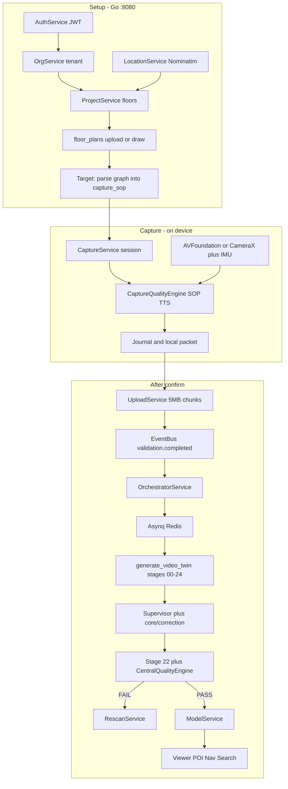

# VĀSTU Spatial — Floorplan-Guided Capture, On-Device Co-Pilot & Cloud Supervisor

**Document Version**: 3.0.0  
**Status**: Target architecture mapped onto the **live** service flows  
**Companions**: [SERVICE_TO_SERVICE_ARCHITECTURE.md](./SERVICE_TO_SERVICE_ARCHITECTURE.md) (who calls whom), [TECHNICAL_SYSTEM_MANUAL.md](./TECHNICAL_SYSTEM_MANUAL.md) (every constant, schema, and gate)

This document is the same product as v2 (blueprint + offline capture AI + reconstruction self-correction) written as the **actual operator path**: Auth → ProjectService floors → floor_plans → CaptureService SOP → on-device CaptureQualityEngine → UploadService → Orchestrator/Asynq → 25-stage twin worker → quality/rescan → Model/Viewer.

It does **not** invent a parallel stack.

---

## 1. Three ideas, attached to real services

| Idea | Why | Lives in |
|---|---|---|
| Floorplan is ground truth | Tells the system what walls and rooms **should** be, in meters | `ProjectService` + `floor_plans` + (target) parser writing `captures.capture_sop` |
| On-device co-pilot | Basements have no usable cloud. Bad motion is cheaper to stop on the phone than to repair in Open3D | iOS/Android `CaptureQualityEngine` + IMU + journal. **No** SOP/job/quality HTTP while recording |
| Cloud supervisor | Depth still wrinkles walls or holes the floor | In-process loop inside `VastuDigitalTwinPipeline` using `core/correction` knobs + stage 22 scores — not a new HTTP microservice |

Zero cloud means **zero reconstruction and SOP API bytes during Record**. Project download, login, and post-scan upload remain cloud by design.

---

## 2. System flow (not a generic 3-phase cartoon)

---

## 3. Step-by-step on the real path

### Step 1 — Identity (`AuthService`, `OTPService`, `OrgService`)

**Why**: Every project, capture, and twin is tenant-scoped. JWT carries `org_id` so workers and clients do not mix companies.

### Step 2 — Create project and floors (`ProjectService`, `LocationService`)

**Why**: A twin belongs to a site with named floors and metric area/height. Nominatim fills address/lat-lng in the wizard so the project is a real building, not a loose video file.

UI: [ProjectCreationWizard.tsx](../src/pages/projects/ProjectCreationWizard.tsx), iOS/Android wizards. API: `POST /api/v1/projects`, `POST /projects/{id}/floors`.

### Step 3 — Attach blueprint (`ProjectService` floor-plan APIs)

**Why**: The 2D plan is the only cheap source of “this polygon is a room” and known lengths for `FloorplanDimensionEvidence` (scale priority 3 in `core/alignment/estimator.py`).

| API | Why |
|---|---|
| `POST .../floor-plan/upload` | PDF/PNG from architect |
| `POST .../floor-plan/draw` | Vector walls already in `drawing_data` JSON — easiest to parse |
| `GET .../floor-plan` | Phone downloads the plan **before** Record |

Store: `floor_plans` (file URL + `drawing_data` + `scale_ratio`).

**Target parser (cloud, after save, not during filming):** walls, doors, windows, room polygons → JSON graph → copy into `captures.capture_sop` (column already in migration 000019). That JSON is the on-device checklist.

Web `SpatialSOPService` cloud vision is **only** allowed as a fallback for this pre-capture parse. It must not run on a timer in Guided Capture Studio.

### Step 4 — Assign capture (`CaptureService`, QR)

**Why**: Reconstruction jobs need a capture UUID, floor, operator, and SOP blob. QR pairing ([QRScannerView](../ios/VastuSpatial/Views/QRScannerView.swift), Android QR screen, [GuidedCaptureStudioPage](../src/pages/capture/GuidedCaptureStudioPage.tsx)) exists so the phone does not type UUIDs.

### Step 5 — Offline record (`CaptureQualityEngine`)

**Why over 80% of mesh failures start here**: pivot-only video, blur, skipped floor.

Existing engine (iOS/Android, mirrored in `core/sop/sop_engine.py`):

1. 11 SOP stages (entry → perimeter → walls → corners → doors → windows → **floor** → ceiling → center → loop → verify).
2. Quality signals: motion blur, overlap, feature density, low light.
3. TTS priorities: critical > warning > guidance.

**Target overlay** (same engine, not a new app): load `capture_sop` zones; tick north wall / floor polygon; block Finish while required zones are red. IMU translation-vs-rotation already belongs here (“walk sideways, do not twist in place”). CoreML/TFLite 60 FPS is a later increment on this same HUD — not a requirement to wire SOP JSON.

Camera stays AVFoundation/CameraX writing a local packet (`LocalCaptureStorageManager`, journal, recovery). **No** `/jobs`, `/quality`, or SOP HTTP until Confirm.

### Step 6 — Upload (`UploadService`)

**Why**: 5 MB chunks + SHA-256 + quarantine. Field Wi-Fi dies; the worker must never open a truncated MOV.

`POST /uploads/init` → chunk → `complete` → EventBus `validation.completed`.

### Step 7 — Spawn reconstruction (`OrchestratorService`, `JobService`, Asynq)

**Why**: HTTP times out at 60s; a twin takes tens of minutes. Redis/Asynq owns the chain:

preprocess → SFM → depth → fuse → mesh → texture → semantics → QA → finalize.

Each handler in [backend/internal/pkg/queue/handlers.go](../backend/internal/pkg/queue/handlers.go) shells a file under `backend/workers/` and enqueues the next type. Progress is written so the dashboard can poll `JobService`.

Preferred body for mesh quality: [scripts/generate_video_twin.py](../scripts/generate_video_twin.py) via [v3_reconstruction_engine.py](../backend/workers/pipeline/v3_reconstruction_engine.py) (stages 00–24 including reprojection, quality, recovery, provenance). FastAPI `EndToEndWorkflowOrchestrator` is the 22-stage **test/contract** path, not a second production mesher.

### Step 8 — Supervisor loop (inside the twin worker)

**Why**: Monocular depth still wrinkles walls and holes floors even with a good capture.

| Fault | How it is caught | Command (existing knobs) |
|---|---|---|
| Tin-foil wall | Normal variance vs floorplan wall plane | Increase Taubin iterations, enlarge normal radius, linear fit |
| Floor hole | Mesh vs room polygon, Y near 0 | Solid floor prior inside hull |
| Clipped recess | Video depth/extent vs mesh AABB | Expand clip envelope; stop largest-cluster prune |
| Photometric miss | Stage 21 reprojection vs keyframe | Re-weight visibility blend / exposure |

Write every pass to `23_recovery/recovery_log.json`. Cap retries (3). Pass when stage 22 overall ≥ 0.98 **and** critical gates hold. Use `ArchitecturalGeometryCorrector` (`core/correction`) rather than inventing geometry.

Feed parsed plan into `FloorplanDimensionEvidence` so scale is not guessed.

### Step 9 — Quality, rescan, publish

- **PASS**: `ModelService` artifacts + MinIO; viewer, `POIService`, `NavigationService`, `SearchService`.
- **FAIL**: `RescanService` card (XYZ + radius + instruction) → phone 5-second patch → `incremental_update_engine` / versioning rescan pipeline. Do not reshoot the building.

AR after publish: FastAPI `/ar/localize` so the same phone can overlay routes on the twin.

---

## 4. Why this mapping (and not a new product)

- Floorplans already upload through **ProjectService**. Parsing must hang off that write.
- SOP JSON already exists on **captures**. Mobile engines already speak 11 stages + TTS. Wire the JSON in; do not rewrite the camera.
- Upload, jobs, and workers already exist. Supervisor is a **loop around stages 11/14/17/21/22**, not a new compose service.
- Go stays tenancy and bytes; Python stays geometry. See the call matrix in the companion doc.

---

## 5. Implementation order (same as service map)

1. Parser after floor-plan save → `capture_sop` + GET on mobile DTOs.
2. `CaptureQualityEngine` loads SOP; Finish gated; no cloud during Record; real floor-plan upload on iOS/Android (replace simulate).
3. Guided Capture Studio reads stored SOP (drop live `VITE_SPATIAL_API_KEY` dependency).
4. Twin worker supervisor + `FloorplanDimensionEvidence`.
5. OrchestratorService reliably enqueues Asynq → v3 engine; rescan on FAIL.
