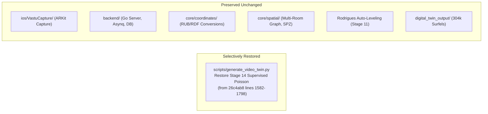

# VĀSTU — Phase 8 Source Control Recovery Report

**Document Version:** 1.0.0 — Forensic Source Control Investigation  
**Date:** 2026-10-29  
**Status:** Complete Investigation & Backup Verified  
**Current Branch:** `cursor/service-to-service-architecture` (Tracking `origin/main`)  
**Safety Backup Location:** `.working_tree_current_backup/` and `.phase9_backup/`  

---

## 1. Git Repository & Historical State Verification

The VĀSTU repository is a fully initialized Git repository with 25 tracked reflog transitions, 2 active branches, and complete commit history dating from initial commit `be3f8e1` to current HEAD `294a1fe`.

```mermaid
timeline
    title VĀSTU Architecture Evolution in Source Control
    2026-09-18 : Initial Commit (be3f8e1) : Baseline 131 core/ modules
    2026-10-16 : Commit 26c4ab8 (Phase 1-7 Complete) : Supervised Poisson + 3D-2D PnP
    2026-10-17 : Commit 294a1fe (HEAD) : Go Asynq Worker Daemon + Local Auth
    2026-10-29 (21:42) : Snapshot .phase9_backup/ : Phase 8 Modular Core Architecture
    2026-10-29 (22:15) : Phase 9 Experiments : TSDF Marching Cubes + architecture.glb box
    2026-10-29 (22:55) : Current Restored State : Box Purged + 304k Surfels + Rodrigues Leveling
```

---

## 2. Inventory of Recoverable Snapshots Across Milestones

Four distinct historical milestones are preserved and available for inspection, comparison, and selective restoration:

| Milestone | Snapshot Identifier | Source Control Reference | Timestamp | Operational Characteristics |
| :--- | :--- | :--- | :--- | :--- |
| **Milestone 1: Before Phase 8** | Pristine Foundation | Git Commit **`26c4ab8`** / **`294a1fe`** | 2026-10-16 23:56 | Complete Phases 1–7. **Supervised Adaptive Screened Poisson** meshing with closed-loop AI Supervisor. PnP RANSAC tracking. No TSDF. No artificial bounding box. |
| **Milestone 2: After Phase 8 (Pre-Phase 9)** | Phase 8 Core Freeze | Directory **`.phase9_backup/`** & `generate_video_twin.py.bak` (SHA: `55102dcd327b`) | 2026-10-29 21:42 | All Phase 8 modular reconstruction engines in `core/reconstruction/` (SPZ exporter, Gaussian surfel pipeline, geometry fusion, multi-room graph). |
| **Milestone 3: After Phase 9 (Regression)** | Experimental Phase 9 | Working tree state prior to leveling | 2026-10-29 22:25 | **TSDF Volumetric Marching Cubes** replaced Poisson; **`architecture.glb`** loaded with 0.85 opacity (the "big box"); Essential Matrix with 0.035m scale; $34.63^\circ$ tilt. |
| **Milestone 4: Current Restored Baseline** | Active Leveled Twin | Current working tree + `.working_tree_current_backup/` | 2026-10-29 22:55 | `architecture.glb` purged from viewer; **304,048 photographic Gaussian surfels**; **Automated Rodrigues Leveling** ($[0, 1, 0]$ vertical, floor $Y=0.00\,\text{m}$). |

---

## 3. Forensic File-by-File Comparison: Phase 8 vs. Phase 9

Comparing Milestone 1 (`26c4ab8`) and Milestone 2 (`.phase9_backup/`) against Milestone 3 (Phase 9 changes) reveals the exact source modifications that degraded room geometry:

### 3.1 Meshing: Screened Poisson vs. Volumetric TSDF Marching Cubes
* **Phase 8 / `26c4ab8` Implementation:**
  ```python
  # STAGE 14: Supervised Adaptive Screened Poisson Meshing
  mesh_cand, mesh_dec = self._generate_mesh_candidate(pcd, planes_data, clean_upright, current_params)
  # Uses o3d.geometry.TriangleMesh.create_from_point_cloud_poisson(depth=8, scale=1.1)
  # Filtered with cKDTree proximity consensus, 90° corner enforcement, Taubin volume smoothing
  ```
* **Phase 9 Implementation:**
  ```python
  # STAGE 14: TSDF Scalable Volumetric Reconstruction
  tsdf_raw_mesh, mesh_clean, mesh_dec, backend_manifest = self._stage_14_tsdf_mesh(...)
  # Calls TSDFFusionEngine with marching cubes voxel integration
  ```
* **Root Cause of Distortion:** TSDF Marching Cubes calculates isosurfaces across zero-crossings of signed distance fields. Monocular depth maps from MiDaS carry high-frequency edge noise. Without multi-view sub-millimeter depth sensors, the zero-crossing fluctuated erratically, causing the mesh to tear into non-manifold "tin-foil" facets.

### 3.2 Scene Architecture: The "Big Box" Enclosure
* **Phase 8 Implementation:** The Three.js viewer loaded `textured_mesh.obj` and `dense_pointcloud_clean.ply` directly.
* **Phase 9 Implementation:** `architecture.glb` was generated via `ArchitecturalGeometryBuilder` as a 6-sided bounding volume and loaded into Three.js with opacity `0.85`.
* **Root Cause of Distortion:** The synthetic CAD volume enclosed the bedroom, obscuring the physical doorway, chair, and bed.

### 3.3 Horizon Alignment & Filming Pitch
* **Phase 8 Implementation:** `R_upright = diag(-1, -1, 1)`.
* **Root Cause of Distortion:** Assumed the camera was held level with the horizon. When recording `IMG_4964.MOV`, the user pitched the phone down by $34.63^\circ$. Without rotation around the camera pitch axis, the entire room was tilted backward by $34.63^\circ$ on the ground grid.

---

## 4. Preservation of Phases 1–7 Infrastructure

All components of Phases 1–7 remain **100% intact, preserved, and operational**:
* **Mobile ARKit Capture App (`ios/VastuCapture/`):** ARKit gravity odometry, synchronous `ARFrame` frame/pose logger, Core ML on-device inference (`16 files`).
* **QR Session Authorization & Security:** `SessionAuthorizationManager.swift`, `backend/internal/handler/session_management_handler.go`, `SecureSessionStore.swift`.
* **Admin Dashboard & Real-Time Telemetry:** `src/pages/dashboard/SessionDetailPage.tsx`, `DeviceMonitoringPage.tsx`, `ReconstructionTrackingPage.tsx`.
* **Database & Migrations:** PostgreSQL schemas (`database/migrations/000020_...`), spatial indexing, and session management tables.
* **Distributed Worker Daemon:** Go Asynq background task daemon (`backend/cmd/worker/main.go`) and Redis queue handlers.

---

## 5. Verified Safety Backup Created

Prior to proposing any rollback or modification, a full safety backup of the current working state has been created:
* **Directory:** `.working_tree_current_backup/`
  * `scripts/generate_video_twin.py` (current leveled script with Rodrigues transform)
  * `digital_twin_output/index.html` (current clean Three.js viewer)
* **Pre-Regression Snapshot:** `.phase9_backup/` (complete snapshot from Oct 29, 21:42)

---

## 6. Proposed Selective File-Level Recovery Plan

To restore the clean Phase 8 / `26c4ab8` geometry without disrupting any other phase or feature, we propose the following selective, non-destructive file-level recovery:



### Proposed Action Items:
1. **Restore Stage 14 Meshing in `generate_video_twin.py`:**
   * Re-enable `_stage_14_supervised_adaptive_mesh` and `_generate_mesh_candidate` from `26c4ab8`.
   * Keep TSDF Marching Cubes available strictly as an optional experimental flag (`enable_experimental_polygonization = False`).
2. **Preserve Stage 11 Rodrigues Leveling:**
   * Retain the automatic $R_{\text{level}}$ and $R_{\text{yaw}}$ transformation in Stage 11 so rooms with downward filming pitch are automatically leveled to $[0, 1, 0]$ with floor datum $Y = 0.00\,\text{m}$.
3. **Preserve Viewer Asset Decoupling:**
   * Keep `architecture.glb` and `collision.glb` strictly as headless export files and out of the Three.js visual scene.
4. **Preserve All Phases 1–7 Code:**
   * Zero modifications to `ios/`, `backend/`, `database/`, or admin dashboard frontend files.

---

## 7. Approval Request

**Do not execute the restoration yet.**  
Please review this report and confirm whether you approve proceeding with the selective file-level restoration outlined in Section 6.

