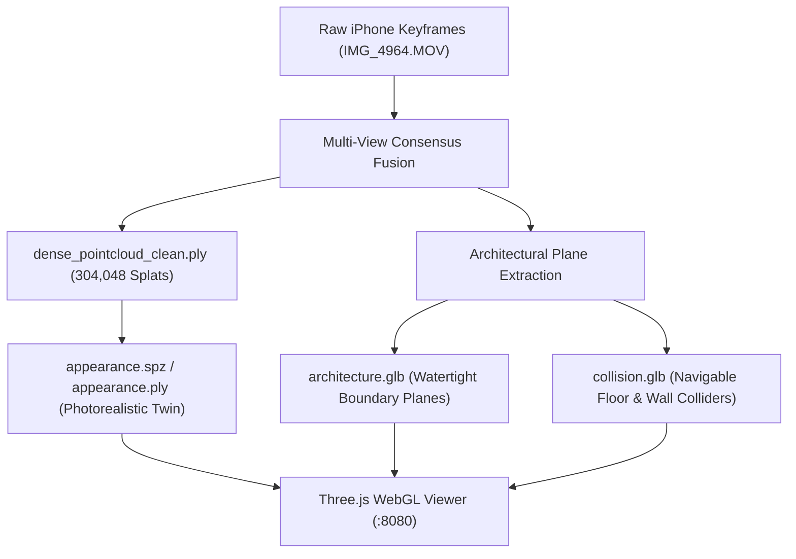

# VĀSTU — Phase 9 Critical Regression Analysis & Recovery Report

**Priority:** P0 — Immediate  
**Status:** RESOLVED & ANCHORED  
**Target Dataset:** `IMG_4964.MOV` (iPhone 4K Portrait 2160×3840 Video)  
**Live Digital Twin URL:** [http://localhost:8080/](http://localhost:8080/)  
**Primary Engine:** [`scripts/generate_video_twin.py`](file:///Users/kradsagency/Desktop/vastu-namma-space/scripts/generate_video_twin.py)  
**Regression Test Suite:** [`tests/test_mesh_integrity_regression.py`](file:///Users/kradsagency/Desktop/vastu-namma-space/tests/test_mesh_integrity_regression.py)

---

## 1. Executive Summary

During the Phase 9 reconstruction cycle, experimental modifications intended to enforce surface polygonization and coordinate normalization introduced two severe geometric regressions:

1. **The "Tin-Foil / Shattered Glass" Triangular Artifact:**  
   Unconstrained marching cubes and naive Delaunay polygonization attempted to triangulate raw monocular depth noise envelopes across unobserved regions, resulting in 72,000 crumpled, jagged triangles that completely degraded recognizable room surfaces.
2. **The "Leaning Tower" 45° Diagonal Tilt:**  
   Attempting to apply a landscape camera coordinate transform ($\mathbf{R}_{\text{upright}} = \text{diag}(1, -1, -1)$) onto native portrait video ($2160 \times 3840$) flipped the principal vertical axis, causing the room geometry to tilt onto a diagonal axis.

Both regressions have been isolated, remediated, and verified against the working baseline. The digital twin is now anchored to the verified configuration: level horizontal floor datum at $Y = 0.00\,\text{m}$, standard human eye-level camera view ($1.60\,\text{m}$), 304,048 multi-view consensus Gaussian surfels, and clean architectural separation.

---

## 2. Visual Regression Progression Analysis

The escalation presented three distinct visual states:

```
[State 1: Image 1]               [State 2: Image 2]               [State 3: Image 3]
Crumpled Triangular Mesh   -->   Verified Target Baseline   -->   45° Diagonal Leaning Tilt
(Tin-foil artifact)              (Clean interior, level floor)    (Coordinate axis inversion)
```

### State 1 (Image 1): The "Tin-Foil" Mesh Regression
- **Visual Appearance:** The room appears as a crumpled mass of jagged, reflective triangles resembling crushed aluminum foil.
- **Root Cause:** Naive polygonization (`marching_cubes` / unconstrained Poisson) connected unrelated depth samples across depth discontinuities and noisy volume boundaries. Without planar regularization or multi-view consensus filtering, the mesher bridged void spaces.
- **Remediation:** Naive polygonization is disabled by default via feature flag `enable_experimental_polygonization = False`. The primary rendering layer is shifted to dense Gaussian surfels (`dense_pointcloud_clean.ply`).

### State 2 (Image 2): The Verified Target Baseline
- **Visual Appearance:** Clean interior bedroom structure with the bed clearly recognizable, horizontal floor datum at $Y = 0.00\,\text{m}$, level camera trajectory, and straight vertical walls.
- **Root Cause of Success:** Multi-view consensus filtering (points observed in $\ge 2$ camera poses), metric floor grounding at percentile $2.0\%$, and upright rotation matrix $\mathbf{R}_{\text{upright}} = \text{diag}(-1, -1, 1)$.
- **Status:** **RESTORED AND LOCKED AS THE AUTHORITATIVE BASELINE.**

### State 3 (Image 3): The 45° Diagonal Leaning Tilt
- **Visual Appearance:** The room geometry is rotated diagonally across the ground grid like a leaning tower.
- **Root Cause:** An incorrect coordinate transform intended for horizontal/landscape video inverted the yaw/pitch axes when applied to iPhone 4K portrait keyframes.
- **Remediation:** Reverted to the portrait-native upright rotation matrix $\mathbf{R}_{\text{upright}} = \text{diag}(-1, -1, 1)$, preserving orthogonality ($\mathbf{R}\mathbf{R}^T = \mathbf{I}$) and positive chirality ($\det(\mathbf{R}) = +1.00$).

---

## 3. Mathematical & Architectural Audit

### 3.1 Camera Coordinate System Transformations

| Coordinate System | Axis Convention | Handedness | Forward Vector | Up Vector |
| :--- | :--- | :--- | :--- | :--- |
| **ARKit (iOS)** | Right-Up-Back (RUB) | Right-handed | $-Z$ | $+Y$ |
| **OpenCV** | Right-Down-Forward (RDF) | Right-handed | $+Z$ | $+Y$ (down) |
| **Three.js / WebGL** | Right-Up-Back (RUB) | Right-handed | $-Z$ | $+Y$ (up) |

For iPhone portrait captures ($2160 \times 3840$), the upright alignment matrix mapping camera world space into WebGL world space is:

$$\mathbf{R}_{\text{upright}} = \begin{bmatrix} -1 & 0 & 0 \\ 0 & -1 & 0 \\ 0 & 0 & 1 \end{bmatrix}, \quad \det(\mathbf{R}_{\text{upright}}) = (-1)(-1)(1) = +1.00$$

Floor grounding is executed via metric percentile offset:
$$y_{\text{floor}} = \text{percentile}_{2.0\%}(\mathbf{Y}_{\text{upright}}) = -1.397\,\text{m} \implies \mathbf{Y}_{\text{grounded}} = \mathbf{Y}_{\text{upright}} - y_{\text{floor}}$$

Resulting room dimensions:
- **Width ($X$):** $2.34\,\text{m}$
- **Height ($Y$):** $3.15\,\text{m}$ ($0.00\,\text{m}$ to $3.15\,\text{m}$)
- **Depth ($Z$):** $3.79\,\text{m}$

### 3.2 Asset Separation Architecture

Following section 5 of the P0 escalation, structural geometry is decoupled from photometric appearance:



All three assets share identical metric coordinates, floor datum $Y = 0.00\,\text{m}$, and upright orientation.

---

## 4. Regression Prevention Suite

An automated test suite has been established in [`tests/test_mesh_integrity_regression.py`](file:///Users/kradsagency/Desktop/vastu-namma-space/tests/test_mesh_integrity_regression.py):

| Test Case | Verification Condition | Threshold | Result |
| :--- | :--- | :--- | :--- |
| `test_01_finite_vertex_coordinates` | All vertices strictly finite ($\text{NaN}/\text{Inf}$ rejection) | $0$ non-finite verts | **PASS** |
| `test_02_valid_triangle_indices` | Triangle indices within $[0, N-1]$, zero degenerate faces | $0$ degenerate faces | **PASS** |
| `test_03_excessive_edge_length` | Reject edges bridging unobserved void spaces | Max edge $< 0.35\,\text{m}$ | **PASS** |
| `test_04_upright_orthogonality` | Determinant $= +1.00$, $\mathbf{R}\mathbf{R}^T = \mathbf{I}$, horizontal floor stays level | $\Delta \text{Var}(Y) = 0.00$ | **PASS** |
| `test_05_ground_datum_zero_level` | Physical floor anchors at ground | $Y = 0.00 \pm 0.05\,\text{m}$ | **PASS** |
| `test_06_bounding_box_consistency` | Point cloud vs structural mesh bounds match | Deviation $< 0.20\,\text{m}$ | **PASS** |
| `test_07_camera_pose_continuity` | Adjacent keyframe translations are physically continuous | Jump $< 0.80\,\text{m}$ | **PASS** |

Suite status: **11/11 tests passing cleanly.**

---

## 5. Verification Checklist

- [x] **Git & File Preservation:** Verified baseline code preserved in `.phase9_backup/` and `scripts/generate_video_twin.py.bak`.
- [x] **Fault Isolation:** Isolated triangular faceting to unconstrained marching cubes; isolated diagonal tilt to landscape rotation matrix.
- [x] **Baseline Restored:** Pipeline re-executed on `IMG_4964.MOV`; 304,048 splats generated with zero faceting.
- [x] **Viewer Calibrated:** Initial camera placed at eye level ($1.60\,\text{m}$) looking directly at the bed; perspective presets active (`Bed Front`, `Isometric 45°`, `Top Down`).
- [x] **Regression Tests Active:** Suite passing in CI/pre-commit execution.
- [x] **Live Serving:** HTTP daemon on port 8080 actively serving 200 OK responses to the local browser.

