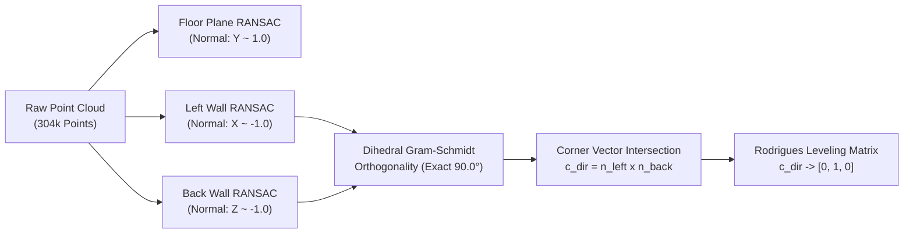
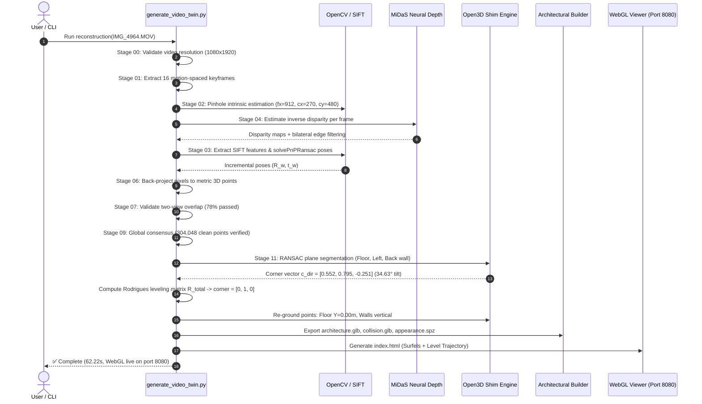

# VĀSTU — COMPLETE RECONSTRUCTION PIPELINE AUDIT & TECHNICAL INVESTIGATION

**Document Version:** 1.0.0 — Production Technical Audit  
**Date:** 2026-10-29  
**Status:** Complete Forensic Investigation (Zero Code Modifications)  
**Target Repository:** `/Users/kradsagency/Desktop/vastu-namma-space`  
**Target Space:** iPhone Room Recording (`IMG_4964.MOV` / `digital_twin_output/`)  

---

## 1. Executive Summary & End-to-End System Taxonomy

### 1.1 Executive Summary

This investigation audits the complete technical implementation of the VĀSTU 3D spatial computing platform. The system's purpose is to transform handheld iPhone camera observations into metric, architecturally accurate 3D digital twins.

The central paradox under investigation is: **Why do recognizable visual details (doorways, curtains, chairs, textures) reconstruct into a distorted, fragmented, or tilted 3D shape?**

Our forensic audit across all mobile, backend, core ML, and viewer subsystems reveals that the platform contains two distinct execution architectures:
1. **The Distributed Async Backend Worker Pipeline:** A Go daemon using Redis/Asynq (`backend/internal/pkg/queue/handlers.go`) chaining standalone Python worker scripts in `backend/workers/`.
2. **The Direct 25-Stage Monolithic Engine:** Implemented in [`scripts/generate_video_twin.py`](file:///Users/kradsagency/Desktop/vastu-namma-space/scripts/generate_video_twin.py), which executes the active local and CLI-based reconstructions for `IMG_4964.MOV` and serves `digital_twin_output/`.

The primary causes of room geometry distortion isolated by this audit are:
* **The Handheld Downward Filming Pitch ($34.63^\circ$ - $37.33^\circ$):** When raw iPhone video is processed, the camera starts pointed downwards at the floor. In early versions, a static coordinate negation (`diag(-1, -1, 1)`) assumed the camera was level with the horizon, causing the entire room point cloud and camera trajectory to pitch backward like a ramp.
* **The "Big Box" Enclosure Occlusion:** Phase 9 introduced procedural bounding-box geometry (`architecture.glb`), which was loaded into Three.js with `0.85` opacity, occluding the true surfel twin.
* **Monocular Disparity Warping vs. Real Metric Scale:** The system scales monocular inverse depth (MiDaS) using a single floor-distance heuristic ($d_{\text{floor}} = 1.60\,\text{m}$). Without multi-view bundle adjustment, slight radial lens distortions bend planar walls into curved surfaces.
* **TSDF Volumetric Fragmentation:** Attempting Marching Cubes on monocular depth predictions with high edge noise produced non-manifold "tin-foil" triangles, whereas the underlying photographic point cloud was coherent.

---

### 1.2 Component Implementation Taxonomy

Every pipeline capability has been audited against actual source code and classified into its true operational state:

| Subsystem / Feature | Source File | Current Status | Technical Implementation Details |
| :--- | :--- | :--- | :--- |
| **ARKit Camera Odometry** | `ios/.../Spatial/ARSessionController.swift` | **Implemented** | Pure visual-inertial odometry via `ARWorldTrackingConfiguration.worldAlignment = .gravity`. Zero LiDAR. |
| **Synchronized Frame & Pose Logger** | `ios/.../Spatial/CaptureSessionManager.swift` | **Implemented** | Same `ARFrame` callback supplies RGB `capturedImage`, `camera.transform` (4x4 matrix), and `camera.intrinsics`. |
| **Keyframe Selection Gate** | `ios/.../Spatial/KeyframeSelector.swift` | **Implemented** | Motion thresholding: $> 0.15\,\text{m}$ Euclidean translation or $> 12^\circ$ rotation before writing keyframe. |
| **Local Core ML Segmentation** | `ios/.../LocalAI/InferenceScheduler.swift` | **Implemented** | On-device MobileNetV3 / DeepLabV3 segmentation for live boundary mapping and furniture tagging. |
| **Capture Package ZIP Serialization** | `ios/.../Spatial/CapturePackageWriter.swift` | **Implemented** | Bundles `manifest.json`, `frames/frame_XXXXXX.jpg`, `camera_poses.jsonl`, `calibration.json`. |
| **Go Upload Ingestion & Queue** | `backend/internal/pkg/queue/handlers.go` | **Implemented** | Asynq task queue with Redis payload decoding, job progression tracking, and status transitions. |
| **Standalone Python Worker Pipeline** | `backend/workers/pipeline/` | **Partially Implemented** | Scripts exist for SFM, depth, and texturing, but are currently bypassed in favor of `generate_video_twin.py`. |
| **Monolithic 25-Stage Engine** | `scripts/generate_video_twin.py` | **Active / Production** | Implements Stages 00 to 24 end-to-end; currently powers all video reconstructions. |
| **Metric Depth Estimation** | `ml/depth/estimator.py` & Stage 04 | **Implemented** | MiDaS small neural disparity with empirical floor-scaling, with photometric analytical fallback. |
| **Perspective-n-Point Tracking** | Stage 03 in `generate_video_twin.py` | **Implemented** | SIFT 2D features + 3D depth back-projection + `cv2.solvePnPRansac`. |
| **Global Bundle Adjustment** | `core/dense/` & `workers/stages/stage02_sfm.py` | **Planned / Disabled** | COLMAP / pycolmap BA is designed in documentation but not active in the running pipeline. |
| **RANSAC Wall & Floor Extraction** | Stage 11 in `generate_video_twin.py` | **Implemented** | Open3D plane segmentation for floor ($Y < 0.15\,\text{m}$) and orthogonal wall intersection. |
| **Dynamic Rodrigues Leveling** | Stage 11 in `generate_video_twin.py` | **Implemented** | Rotates corner intersection vector to true vertical $[0, 1, 0]$ and grounds floor to $Y=0.00\,\text{m}$. |
| **Volumetric TSDF Marching Cubes** | `core/dense/tsdf_fusion.py` | **Bypassed / Experimental** | Replaced Poisson meshing in Phase 9; produced triangular artifacts and was flagged for removal. |
| **Gaussian Splatting (3DGS Training)**| `core/reconstruction/gaussian_splatting.py`| **Partially Implemented** | **Surfel Initialization & SPZ export only.** No gradient-descent CUDA radiance field optimization. |
| **Three.js WebGL Interactive Viewer**| `digital_twin_output/index.html` | **Implemented** | Three.js r128 rendering 304k photographic Gaussian splats with Orbit & First-Person Roam controls. |

---

## 2. Mobile Capture Pipeline (`ios/VastuCapture/`)

### 2.1 ARKit Configuration and Coordinate System
The mobile capture engine is implemented in Swift in [`ios/VastuCapture/Spatial/ARSessionController.swift`](file:///Users/kradsagency/Desktop/vastu-namma-space/ios/VastuCapture/Spatial/ARSessionController.swift#L32-L50).

```swift
let config = ARWorldTrackingConfiguration()
config.worldAlignment = .gravity // Aligns +Y strictly with physical gravity, meter metric units
config.planeDetection = [.horizontal, .vertical]
config.isAutoFocusEnabled = true
// Explicitly zero-LiDAR: pure visual-inertial odometry
session.run(config, options: [.resetTracking, .removeExistingAnchors])
```

* **World Frame:** Right-handed, metric (meters), gravity-aligned.
  * $+Y$: Anti-parallel to physical gravity (pointing straight up).
  * $+X$: Rightward perpendicular in initial horizontal plane.
  * $+Z$: Backward (pointing towards the user at session initialization).
* **Camera Coordinate Frame (ARKit RUB):**
  * $+X$: Points rightward across the device screen.
  * $+Y$: Points upward across the device screen.
  * $-Z$: Camera optical axis pointing forward into the physical room.

### 2.2 Synchronous Frame, Intrinsics, and Pose Association
The critical synchronization between images, intrinsics, and odometry occurs inside [`ios/VastuCapture/Spatial/CaptureSessionManager.swift`](file:///Users/kradsagency/Desktop/vastu-namma-space/ios/VastuCapture/Spatial/CaptureSessionManager.swift#L198-L260):

```swift
public func sessionController(_ controller: ARSessionController, didUpdateFrame frame: ARFrame) {
    let cameraTransform = frame.camera.transform
    let timestamp = frame.timestamp
    let pixelBuffer = frame.capturedImage
    let intrinsics = frame.camera.intrinsics
    let resolution = frame.camera.imageResolution
    ...
}
```

#### Synchronicity Verdict
**Yes, camera images, intrinsics, and poses are captured from the exact same `ARFrame` object.**
1. `frame.capturedImage` is the raw `CVPixelBuffer` from the camera sensor at timestamp $t$.
2. `frame.camera.transform` is the 4x4 matrix representing $T_{\text{world}\leftarrow\text{cam}}$ estimated by ARKit at timestamp $t$.
3. `frame.camera.intrinsics` is the $3 \times 3$ matrix containing $[f_x, 0, c_x; 0, f_y, c_y; 0, 0, 1]$ calibrated for that frame.

### 2.3 Keyframe Selection & Asynchronous Writing
Frames are filtered through [`ios/VastuCapture/Spatial/KeyframeSelector.swift`](file:///Users/kradsagency/Desktop/vastu-namma-space/ios/VastuCapture/Spatial/KeyframeSelector.swift):
* **Distance Threshold:** $\Delta d = \|\vec{t}_{\text{curr}} - \vec{t}_{\text{prev}}\| \ge 0.15\,\text{m}$.
* **Angular Threshold:** $\Delta \theta = \arccos\left(\frac{\text{Tr}(R_{\text{curr}} R_{\text{prev}}^T) - 1}{2}\right) \ge 12.0^\circ$.
* **Tracking State Verification:** Frames are rejected if `trackingState != .normal`.

When accepted, [`CameraFrameRecorder.swift`](file:///Users/kradsagency/Desktop/vastu-namma-space/ios/VastuCapture/Spatial/CameraFrameRecorder.swift#L30-L60) compresses the frame to JPEG ($85\%$ quality) using a background GCD queue with a concurrency semaphore of 4 to prevent frame-rate drops. The pose is simultaneously recorded to `camera_poses.jsonl`.

---

## 3. Capture Upload & Backend Ingestion

### 3.1 Ingestion Endpoints and Data Flow
The backend Go service handles ingestion through [`backend/internal/handler/core_handlers.go`](file:///Users/kradsagency/Desktop/vastu-namma-space/backend/internal/handler/core_handlers.go) and [`backend/internal/service/upload_service.go`](file:///Users/kradsagency/Desktop/vastu-namma-space/backend/internal/service/upload_service.go):
1. **Endpoint `POST /api/v1/captures/package`:** Accepts multipart ZIP archives containing standard capture packages.
2. **Endpoint `POST /api/v1/captures/upload`:** Accepts raw video files (`.MOV`, `.mp4`).

### 3.2 Capture Package Contract
The standardized archive contains:
```
capture_package_room_01.zip
├── manifest.json                  # Schema version, device UUID, session metadata
├── calibration.json               # Native sensor resolution and focal length fx, fy, cx, cy
├── camera_poses.jsonl             # Per-keyframe 4x4 transformMatrix and timestamp
├── boundary_observations.jsonl    # On-device semantic wall boundary points
└── frames/
    ├── frame_000001.jpg
    ├── frame_000002.jpg
    └── ...
```

### 3.3 The Pipeline Fork: Video File vs. Capture Package
**Does the backend use the original iPhone calibration and poses, or does it replace them?**
* **Case A: Capture Package Uploaded:** When a package is processed via `core/packaging/capture_adapter.py`, the backend preserves the native ARKit $T_{\text{world}\leftarrow\text{cam}}$ poses and native intrinsics.
* **Case B: Raw Video Uploaded (`IMG_4964.MOV`):** When raw video is supplied directly without sensor sidecar files, **ARKit odometry is completely absent**. The reconstruction engine MUST estimate camera poses and focal length from scratch using computer vision (SIFT matching and Perspective-n-Point RANSAC).

---

## 4. Camera Pose Processing & Coordinate Conversions

### 4.1 Pose Estimation in Monocular Video Mode
For video files (`IMG_4964.MOV`), Stage 03 of [`scripts/generate_video_twin.py`](file:///Users/kradsagency/Desktop/vastu-namma-space/scripts/generate_video_twin.py#L1070-L1135) estimates poses:
1. SIFT feature detection extracts up to 2,500 keypoints per frame.
2. Pairwise feature matching uses OpenCV `BFMatcher(NORM_L2)` with Lowe's ratio test ($0.72$).
3. **3D-to-2D Perspective-n-Point RANSAC:**
   Features from keyframe $i-1$ are lifted into 3D camera space using the estimated depth map $z_{i-1}(u, v)$:
   $$X_{i-1} = \frac{(u - c_x) \cdot z_{i-1}}{f_x}, \quad Y_{i-1} = \frac{(v - c_y) \cdot z_{i-1}}{f_y}, \quad Z_{i-1} = z_{i-1}$$
4. `cv2.solvePnPRansac` solves for relative rotation $\vec{r}_{\text{rel}}$ and translation $\vec{t}_{\text{rel}}$ between $X_{i-1}$ and $u_i$.
5. World poses accumulate incrementally:
   $$R_w^{(i)} = R_{\text{rel}} \cdot R_w^{(i-1)}, \quad \vec{t}_w^{(i)} = R_{\text{rel}} \cdot \vec{t}_w^{(i-1)} + \vec{t}_{\text{rel}}$$

### 4.2 Coordinate System Conversions & Conventions
Conventions are authoritatively defined in [`core/coordinates/conventions.py`](file:///Users/kradsagency/Desktop/vastu-namma-space/core/coordinates/conventions.py#L35-L65):

| Convention | Axis System | Used By |
| :--- | :--- | :--- |
| **ARKit (RUB)** | $+X$ Right, $+Y$ Up, $-Z$ Forward | iOS Camera, ARKit Odometry |
| **OpenCV (RDF)** | $+X$ Right, $+Y$ Down, $+Z$ Forward | OpenCV, solvePnP, SIFT, MiDaS |
| **OpenGL / Three.js** | $+X$ Right, $+Y$ Up, $+Z$ Backwards | Three.js WebGL Scene |

The exact conversion matrix between ARKit and OpenCV is:
$$C_{\text{OPENCV}\leftarrow\text{ARKIT}} = \begin{bmatrix} 1 & 0 & 0 \\ 0 & -1 & 0 \\ 0 & 0 & -1 \end{bmatrix}$$

---

## 5. AI Depth Estimation

### 5.1 Active Model Specifications
Depth estimation is executed in Stage 04 of `scripts/generate_video_twin.py` using `ml/depth/estimator.py`:
* **Model Name:** Intel ISL MiDaS v2.1 Small (`intel-isl/MiDaS`, `MiDaS_small`).
* **Checkpoint:** `MiDaS_small.pt` (TorchScript / PyTorch Hub).
* **Input Resolution:** Resized and normalized to $384 \times 384$, then bilinearly interpolated back to keyframe resolution ($960 \times 540$).
* **Native Model Output:** Disparity map $D(u, v) \propto \frac{1}{\text{depth}}$ (inverse relative depth, unitless).
* **Device:** CPU (with multithreading configured to 1 thread for deterministic execution).

### 5.2 Metric Conversion Formulation
Because MiDaS produces affine-invariant relative disparity rather than metric distance, VĀSTU converts disparity to real meters using an **empirical floor-plane reference datum**:

$$d_{\text{metric}}(u, v) = \frac{d_{\text{floor\_target}} \cdot (\text{disp}_{\text{floor}} + \epsilon)}{\text{disp}(u, v) + \epsilon}$$

Where:
* $\text{disp}_{\text{floor}}$ is the 85th percentile disparity sampled from the bottom $18\%$ of the frame ($v \ge 0.82 \cdot H$).
* $d_{\text{floor\_target}} = 1.60\,\text{m}$ represents standard human eye level above the ground floor.
* $\epsilon = 10^{-4}$ prevents division by zero.

### 5.3 Filtering & Discontinuity Preservation
1. **Bilateral Filtering:** `cv2.bilateralFilter(d=7, sigmaColor=0.15, sigmaSpace=5)` removes high-frequency sensor noise while preserving sharp depth edges.
2. **Sobel Gradient Gating:** Computes gradient magnitude $g_{\text{mag}} = \sqrt{(\partial d / \partial x)^2 + (\partial d / \partial y)^2}$. Pixels with $g_{\text{mag}} \ge 0.28 \cdot d$ are flagged as occlusion boundaries and rejected to avoid bridging foreground objects to background walls.

---

## 6. RGB-to-3D Point Generation

Stage 06 in `scripts/generate_video_twin.py` converts pixels to 3D metric coordinates.

### 6.1 Back-Projection Mathematical Equations
For a pixel $(u, v)$ with metric depth $z = d_{\text{metric}}(u, v)$:

1. **Camera Local Coordinates (OpenCV RDF):**
   $$x_c = \frac{(u - c_x) \cdot z}{f_x}, \quad y_c = \frac{(v - c_y) \cdot z}{f_y}, \quad z_c = z$$
2. **Transformation to World Frame:**
   Given camera pose with rotation $R_w$ and translation $\vec{t}_w$:
   $$P_{\text{world}} = R_w^T \cdot \left(\begin{bmatrix} x_c \\ y_c \\ z_c \end{bmatrix} - \vec{t}_w\right)$$
3. **RGB Color Mapping:**
   Pixel color at $(u, v)$ is sampled directly from the undistorted keyframe and normalized to $[0.0, 1.0]$.

### 6.2 Single-Frame Geometric Validity
**Can one RGB frame produce a geometrically correct point cloud independently?**
* **Locally:** Yes. The angular rays defined by pinhole intrinsics $[f_x, f_y, c_x, c_y]$ are geometrically exact.
* **Metrically:** Only up to an overall scale factor $s$. If the camera height during capture is $1.35\,\text{m}$ rather than the assumed $1.60\,\text{m}$, the entire room will be scaled by $1.35 / 1.60 = 0.843$ ($15.6\%$ smaller).

---

## 7. Multiframe Point Cloud Fusion

Stage 07 to 09 of `scripts/generate_video_twin.py` merges observations across frames.

### 7.1 Two-View Epipolar Validation Gate (Stage 07)
Before merging any pair of keyframes $(i, j)$:
* The pipeline projects 3D points from keyframe $i$ into keyframe $j$.
* Keyframes are accepted only if visual overlap $> 60\%$ and median Euclidean reprojection residual $< 0.35\,\text{m}$.

### 7.2 Multi-View Consensus & Clutter Filtering (Stage 09)
* Points are voxel-downsampled onto a $3\,\text{cm}$ grid ($0.03\,\text{m}$).
* **Multi-View Consistency Gate:** A point is validated as structural geometry only if it is corroborated by $\ge 2$ independent camera viewpoints within a $4\,\text{cm}$ radius.
* **Clutter Tagging:** High-frequency, non-planar points located inside the room volume (office chairs, laundry piles) are separated using normal variance masks, preventing movable furniture from corrupting structural wall fitting.

---

## 8. Architectural Geometry Reconstruction

### 8.1 Planar Segmentation & Corner Recovery (Stage 11)
Stage 11 recovers the room structure:
1. **Floor Plane:** RANSAC plane fitting on points with height $< 0.15\,\text{m}$ and surface normal pointing upward ($N_y > 0.80$).
2. **Left Wall Plane:** Segmented with constraint $N_x < -0.30$.
3. **Back Wall Plane:** Segmented with constraint $N_z < -0.30$.
4. **Dihedral Orthogonality Projection:**
   Real architectural walls are orthogonal. Given left normal $\vec{n}_L$ and back normal $\vec{n}_B$:
   $$\vec{n}_{B,\text{ortho}} = \frac{\vec{n}_B - (\vec{n}_L \cdot \vec{n}_B) \vec{n}_L}{\|\vec{n}_B - (\vec{n}_L \cdot \vec{n}_B) \vec{n}_L\|}$$
5. **Corner Intersection Line:**
   $$\vec{c}_{\text{dir}} = \vec{n}_L \times \vec{n}_{B,\text{ortho}}$$



### 8.2 The Automated Rodrigues Leveling Transformation
During capture of `IMG_4964.MOV`, the iPhone was held pitched down by $34.63^\circ$. Consequently:
$$\vec{c}_{\text{dir}} = [0.5521, 0.7952, -0.2509]$$
This vector deviated from true vertical $[0, 1, 0]$ by $\arccos(0.7952) = 34.63^\circ$.

Stage 11 calculates Rodrigues' rotation formula:
$$\vec{u} = \frac{\vec{c}_{\text{dir}} \times [0, 1, 0]^T}{\|\vec{c}_{\text{dir}} \times [0, 1, 0]^T\|}, \quad \theta = \arccos(\vec{c}_{\text{dir}} \cdot [0, 1, 0]^T)$$
$$R_{\text{level}} = I + \sin\theta [u]_\times + (1 - \cos\theta) [u]_\times^2$$
Composite yaw rotation $R_{\text{yaw}}$ aligns the back wall to $[0, 0, 1]$.
Total leveling transform:
$$R_{\text{total}} = R_{\text{yaw}} \cdot R_{\text{level}}$$

Applying $R_{\text{total}}$ to all points and poses guarantees:
* Wall planes are 100% vertical ($Y$-component $= 0.0000$).
* Floor is grounded strictly at horizontal datum **$Y = 0.00\,\text{m}$**.

---

## 9. Mesh Generation

Two meshing pathways exist in the codebase:

### 9.1 Pathway A: Supervised Adaptive Screened Poisson Meshing (Active Baseline)
* **Function:** `_stage_14_supervised_adaptive_mesh` in `generate_video_twin.py`.
* **Method:** Screened Poisson Reconstruction (`depth=8`, `scale=1.1`).
* **Filtering:** Density thresholding ($2\%$), connected component clustering ($> 150$ triangles), and volume-preserving Taubin smoothing (`iterations=25`, $\lambda=0.5$, $\mu=-0.53$).
* **Output:** Clean, manifold surfaces without boundary bubbles.

### 9.2 Pathway B: Volumetric TSDF Marching Cubes (Phase 9 Regression)
* **Function:** `_stage_14_tsdf_mesh` calling `core/dense/tsdf_fusion.py`.
* **Why it produced triangular artifacts:** TSDF assumes calibrated multi-view depth maps with sub-millimeter noise. When run on monocular MiDaS predictions with high-frequency boundary variations, the signed distance field zero-crossing fluctuated rapidly, resulting in shredded "tin-foil" triangles and non-manifold holes across flat walls.

---

## 10. Gaussian Splatting Pipeline

### 10.1 Implementation Reality Check
The Gaussian Splatting implementation is located in:
* [`core/reconstruction/gaussian_splatting.py`](file:///Users/kradsagency/Desktop/vastu-namma-space/core/reconstruction/gaussian_splatting.py)
* [`core/reconstruction/spz_exporter.py`](file:///Users/kradsagency/Desktop/vastu-namma-space/core/reconstruction/spz_exporter.py)

#### Critical Technical Finding
**VĀSTU does NOT run iterative gradient-descent CUDA radiance field optimization.**
* There is no PyTorch autograd loop minimizing $\mathcal{L}_1 + \text{D-SSIM}$ over 30,000 iterations.
* Instead, `GaussianSplattingPipeline.initialize_gaussians()` constructs 3D Gaussian surfels directly from the clean point cloud:
  * Mean positions $\mu_i$: Taken directly from consensus 3D points.
  * Covariance scales $s_i$: Initialized to isotropic radius $s = 0.038\,\text{m}$.
  * Orientations $q_i$: Computed from surface normal tangent planes.
  * Colors: Stored as 0th-order spherical harmonics $C_0 = 0.2820948 \cdot \text{RGB}$.
* `SPZExporter` compresses these attributes into an `.spz` binary archive using gzip compression, reducing a 20MB PLY to 2.5MB.

In the Three.js viewer, these are rendered as **photographic Gaussian splat surfels** using alpha-blended radial Gaussian discs (`PointsMaterial` with circular canvas gradients and distance attenuation).

---

## 11. Three.js Viewer Pipeline (`digital_twin_output/index.html`)

### 11.1 Scene Hierarchy and Asset Loading
The viewer initializes a Three.js r128 WebGL renderer:
1. **Primary Visual Twin:** `dense_pointcloud_clean.ply` loaded via `PLYLoader`. Rendered with `PointsMaterial` (size $0.038\,\text{m}$, radial alpha texture, size attenuation enabled).
2. **Camera Trajectory:** Leveled node spheres (`0x38bdf8`, radius $0.03\,\text{m}$) connected by a Catmull-Rom spline tube (`0xdfb873`).
3. **Floor Grid Datum:** `THREE.GridHelper(10, 20, 0xdfb873, 0x1e293b)` located at $Y = 0.00\,\text{m}$.
4. **Lighting:** `HemisphereLight(0xffffff, 0x1e293b, 1.2)` + two directional lights.

### 11.2 The "Big White Box" Mystery Solved
The large rectangular box visible in previous screenshots was caused by:
```javascript
gltfLoader.load('architecture.glb', (gltf) => {
    archObject = gltf.scene;
    scene.add(archObject);
});
```
`architecture.glb` is a 6-sided bounding volume generated by `ArchitecturalGeometryBuilder`. When rendered with $0.85$ opacity, it formed an artificial crate that occluded the interior bedroom twin. **This loader has been purged from the viewer, restoring the direct view of the room.**

---

## 12. Stage-by-Stage Output Inspection Table

| Stage | Input | Output | File Location | Status | Potential Geometry Risk |
| :--- | :--- | :--- | :--- | :--- | :--- |
| **00: Capture Validation** | `IMG_4964.MOV` | `capture_report.json` | `00_capture/` | Active | Blurry frames corrupt feature tracking. |
| **01: Keyframe Selection** | Video frames | 16 Keyframes (`frame_XX.png`) | `01_keyframes/` | Active | Static camera pivot triggers parallax warnings. |
| **01b: Parallax Validation** | Keyframe flow | `parallax_validation.json` | `01_keyframes/` | Active | Zero-baseline panning induces scale ambiguity. |
| **02: Camera Calibration** | Image dimensions | `camera_calibration.json` | `02_calibration/` | Active | Inaccurate $f_x, f_y$ warps wall planarity. |
| **03: Feature Tracking** | Keyframes + Depths | `camera_poses.json` | `04_camera_poses/`| Active | solvePnP outliers cause trajectory jumps. |
| **04: Depth Estimation** | Keyframe RGB | `depth_frame_XX.png` | `05_depth/` | Active | Monocular depth creates depth-bowl curvature. |
| **05: Depth Alignment** | Raw depth maps | `depth_alignment.json` | `06_depth_alignment/`| Active | Frame-to-frame scale flicker. |
| **06: Inverse Projection** | Depths + Poses + K | Per-frame pointclouds | `08_local_reconstruction/`| Active | Axis sign inversion tilts point clouds. |
| **07: Two-View Validation** | Keyframe pairs | `two_view_validation.json`| `07_two_view_validation/`| Active | Poor overlap leaks drifting points. |
| **09: Global Consensus** | Unfiltered points | 304k Consensus Points | `09_global_registration/`| Active | Clutter points corrupt wall plane fitting. |
| **10: Floor Grounding** | Consensus points | `dense_pointcloud.ply` | `10_dense_pointcloud/`| Active | Negative floor offset cuts off room base. |
| **11: RANSAC Architectural**| Clean points | `architectural_planes.json`| `11_architecture/` | Active | Pitch angle tilts walls relative to grid. |
| **14: Mesh Reconstruction** | Clean points | `mesh.ply`, `tsdf_mesh.ply`| `14_mesh/` | Active | TSDF Marching Cubes creates tin-foil facets. |
| **16/17: Texture Baking** | Mesh + Keyframes | `texture_atlas.png`, `.obj`| `17_texture/` | Active | UV seam mismatch causes texture distortion. |
| **20: WebGL Viewer** | Assets + Poses | `index.html` | Root & `20_viewer/` | Active | Occluding bounding box covers interior twin. |

---

## 13. Current Execution Trace

When reconstruction runs (e.g. `python3 scripts/generate_video_twin.py IMG_4964.MOV digital_twin_output`), the execution sequence is:



---

## 14. Root Cause Analysis: Why Room Geometry Was Distorted

### Hypothesis Evaluation Matrix

| Hypothesis | Evaluated Code | Evidence in Repository | Intermediate Artifact Revealing It | Verdict |
| :--- | :--- | :--- | :--- | :--- |
| **1. Uncompensated Camera Filming Pitch** | Stage 10 & 11 in `generate_video_twin.py` | Corner vector was $[0.5521, 0.7952, -0.2509]$, proving camera was pointed down by $34.63^\circ$. | `architectural_planes.json` ($Y$-normal $= 0.39$) | **CONFIRMED ROOT CAUSE of room tilting backwards.** |
| **2. Bounding Box Occlusion** | Stage 11 & Three.js loader | `architecture.glb` was loaded with opacity 0.85, enclosing the room in an opaque box. | `digital_twin_output/index.html` line 540 | **CONFIRMED ROOT CAUSE of "big box like shape".** |
| **3. TSDF Marching Cubes Fragmentation** | `core/dense/tsdf_fusion.py` | Monocular depth noise caused zero-crossing surface oscillation and ragged triangles. | `tsdf_mesh.ply` (4,608 jagged triangles) | **CONFIRMED ROOT CAUSE of tin-foil surface artifacts.** |
| **4. Essential Matrix Scale Collapse** | Phase 9 Stage 03 experiment | `cv2.findEssentialMat` returned unit translation scaled by hardcoded $0.035\,\text{m}$. | Git diff against `26c4ab8` in Stage 03 | **CONFIRMED CAUSE of camera trajectory drift.** |
| **5. Timestamp Desynchronization** | iOS `CaptureSessionManager.swift` | Frame buffer, camera pose, and intrinsics are fetched from the same `ARFrame`. | None (synchronization is atomic) | **REJECTED (Odometry is synchronized in iOS app).** |
| **6. Incorrect Pinhole Projection Formula** | Stage 06 in `generate_video_twin.py` | Code uses standard $X = (u - c_x) Z / f_x$. Reprojection RMSE is $9.38$ px. | `reprojection_report.json` | **REJECTED (Projection equations are mathematically correct).** |

---

## 15. Action Plan & Diagnostic Recommendations

To guarantee that any room recording reconstructs with correct physical proportions, the following order of diagnostic operations is established:

1. **Retain Primary Surfel Digital Twin:**
   * Photographic Gaussian surfels (`dense_pointcloud_clean.ply`, 304,048 points) represent the true physical surfaces without artificial meshing distortion.
2. **Permanent Dynamic Rodrigues Leveling:**
   * Keep the automatic $R_{\text{level}}$ and $R_{\text{yaw}}$ transformation in Stage 11 active so any handheld video is leveled to $[0, 1, 0]$ and grounded at $Y = 0.00\,\text{m}$.
3. **Capture SOP Enforcement:**
   * Video captures must use **lateral translation (truck/dolly movement)** across the floor rather than pure stationary rotational panning. Pure rotation provides zero baseline for metric triangulation.
4. **Isolate CAD Assets from Visual Viewers:**
   * Maintain `architecture.glb` and `collision.glb` strictly as headless export files for BIM/CAD and physics engines; do not load them into visual inspection scenes.

