# VĀSTU Reconstruction Pipeline Call Graph & Active Execution Path Audit

**Document ID:** VASTU-AUDIT-CALL-GRAPH-001  
**Escalation ID:** VASTU-P0-DEEP-REPAIR-002 (Step 0 Delivery)  
**Target File:** `scripts/generate_video_twin.py`  
**Git Baseline Commit:** `9652c22b35e7cb9a1451c8e6474bf4a1314cb63e`  
**Execution Timestamp:** 2026-11-02 17:32:07 +05:30  

---

## 1. Executive Call Graph Overview

The active production pipeline entrypoint is `scripts/generate_video_twin.py:VastuDigitalTwinEngine.run()`. Every reconstruction step executes deterministically across 25 sequential stages.

```mermaid
flowchart TD
    A["Raw Input Video (IMG_3966.MOV)"] --> S00["Stage 00: Capture Validation<br/>cv2.VideoCapture & Laplacian"]
    S00 --> S01["Stage 01: Motion Keyframes<br/>cv2.calcOpticalFlowFarneback"]
    S01 --> S01b["Stage 01b: Parallax Validation Gate<br/>core/reconstruction/alignment.py:trajectory_parallax"]
    S01b --> S02["Stage 02: Pinhole Calibration<br/>core/reconstruction/calibration_reasoner.py"]
    S02 --> S04["Stage 04: Neural Metric Depth<br/>ml/depth/estimator.py / Fallback"]
    S04 --> S03["Stage 03: 3D-2D PnP RANSAC Tracking<br/>cv2.solvePnPRansac + TrackingReasoner"]
    S03 --> S05["Stage 05: Temporal Depth Alignment<br/>core/reconstruction/depth_reasoner.py"]
    S05 --> S06["Stage 06: Pinhole Inverse Projection<br/>X_c = (u-cx)*Z/fx, Y_c = (v-cy)*Z/fy"]
    S06 --> S07["Stage 07: Two-View Validation Gate<br/>Geometric Warp & Depth Consistency"]
    S07 --> S08["Stage 08: Chunk Expansion"]
    S08 --> S09["Stage 09: Global Multi-View Consensus<br/>Point Reprojection (Support >= 2)"]
    S09 --> S10["Stage 10: Point Cloud Grounding<br/>+Y UP, Floor Datum Y=0.00m"]
    S10 --> S11["Stage 11: Architectural RANSAC & Assets<br/>ArchitecturalGeometryBuilder + GLBExporter + SPZExporter"]
    S11 --> S12["Stage 12: Openings Preservation"]
    S12 --> S13["Stage 13: Normal Estimation<br/>o3d.geometry.PointCloud.estimate_normals"]
    S13 --> S14["Stage 14: TSDF Volumetric Fusion<br/>open3d ScalableTSDFVolume + Marching Cubes"]
    S14 --> S15["Stage 15: Mesh Integrity Validation Gate<br/>Non-manifold, boundary, component analysis"]
    S15 --> S16["Stages 16 & 17: UV & Photographic Texturing<br/>TextureReconstructionEngine + GLBExporter"]
    S16 --> S18["Stage 18: Texture Validation Gate<br/>Atlas coverage & sharpness"]
    S18 --> S19["Stage 19: Mipmap Pyramid Generation<br/>cv2.resize (1024, 512, 256, 128)"]
    S19 --> S20["Stage 20: Dual-Mode WebGL Viewer"]
    S20 --> S21["Stage 21: Metric Reprojection Validation<br/>photometric_rmse (Photometric Residual)"]
    S21 --> S22["Stage 22: Permanent Quality Gate<br/>10 Category Evaluation"]
    S22 --> S23["Stage 23: Recovery Log"]
    S23 --> S24["Stage 24: Keyframe Provenance Map"]
```



---

## 2. Stage-by-Stage Function Call Mapping

| Stage | Name | Source File | Exact Function Invoked | Key Underlying Libraries / Modules |
|---|---|---|---|---|
| **00** | Capture Validation | `scripts/generate_video_twin.py` | `_stage_00_capture_validation()` | `cv2.VideoCapture`, `cv2.Laplacian`, `cv2.meanStdDev` |
| **01** | Keyframe Selection | `scripts/generate_video_twin.py` | `_stage_01_keyframe_selection()` | `cv2.calcOpticalFlowFarneback`, `cv2.Laplacian` |
| **01b** | Parallax Validation | `scripts/generate_video_twin.py` | `_stage_01b_parallax_validation()` | `core/reconstruction/alignment.py:trajectory_parallax` |
| **02** | Camera Calibration | `scripts/generate_video_twin.py` | `_stage_calibration_reasoning()`, `_stage_02_camera_calibration()` | `core/reconstruction/calibration_reasoner.py:CalibrationReasoner.reason()` |
| **04** | Depth Estimation | `scripts/generate_video_twin.py` | `_stage_04_depth_estimation()` | `ml/depth/estimator.py:DepthEstimator`, PyTorch MPS |
| **03** | 3D-2D PnP Tracking | `scripts/generate_video_twin.py` | `_stage_03_feature_tracking()` | `cv2.SIFT_create()`, `cv2.solvePnPRansac()`, `core/reconstruction/tracking_reasoner.py:TrackingReasoner.track()` |
| **05** | Depth Alignment | `scripts/generate_video_twin.py` | `_stage_05_depth_alignment()`, `_stage_depth_reasoning()` | `core/reconstruction/depth_reasoner.py:KeyframeDepthReasoner.reason()`, `core/reconstruction/alignment.py:verified_depth_inputs()` |
| **06** | Inverse Projection | `scripts/generate_video_twin.py` | `_run_stages()` (inline) | Pinhole backprojection math: $X_c = (u-c_x)Z/f_x$ |
| **07** | Two-View Validation | `scripts/generate_video_twin.py` | `_stage_07_two_view_gate()` | Multi-view optical flow / depth warp consistency |
| **08** | Chunk Expansion | `scripts/generate_video_twin.py` | `_run_stages()` (inline) | Expansion pyramid tracking |
| **09** | Global Registration | `scripts/generate_video_twin.py` | `_stage_09_global_registration()` | Multi-view point-to-camera consensus test ($\ge 2$ views) |
| **10** | Point Cloud Grounding | `scripts/generate_video_twin.py` | `_run_stages()` (inline) | `open3d.geometry.PointCloud`, Rodrigues leveling, datum $Y=0.00\text{m}$ |
| **11** | Architectural Recovery | `scripts/generate_video_twin.py` | `_stage_11_architectural_recovery()` | `core/reconstruction/architectural_builder.py:ArchitecturalGeometryBuilder`, `core/packaging/glb_exporter.py:GLBExporter`, `core/reconstruction/spz_exporter.py:SPZExporter` |
| **12** | Openings Preservation | `scripts/generate_video_twin.py` | `_stage_12_openings_preservation()` | Structural recess masking |
| **13** | Normal Estimation | `scripts/generate_video_twin.py` | `_stage_13_normal_estimation()` | `open3d.geometry.PointCloud.estimate_normals()` |
| **14** | TSDF Volumetric Fusion | `scripts/generate_video_twin.py` | `_stage_14_tsdf_mesh()` | `core/dense/tsdf_fusion.py:TSDFFusionEngine`, `open3d.pipelines.integration.ScalableTSDFVolume.integrate()`, `extract_triangle_mesh()` |
| **15** | Mesh Validation Gate | `scripts/generate_video_twin.py` | `_stage_15_mesh_validation()` | `open3d.geometry.TriangleMesh` manifold & topology analysis |
| **16-17** | Texture Projection | `scripts/generate_video_twin.py` | `_stage_16_and_17_texture_projection()` | `backend/workers/texturing/texture_reconstruction_engine.py:TextureReconstructionEngine.reconstruct_texture()`, `core/packaging/glb_exporter.py:GLBExporter` |
| **18** | Texture Validation | `scripts/generate_video_twin.py` | `_stage_18_texture_validation()` | `cv2.Laplacian()`, texel density check |
| **19** | Mipmap Pyramid | `scripts/generate_video_twin.py` | `_stage_19_mipmaps()` | `cv2.resize()` (1024, 512, 256, 128) |
| **20** | WebGL Viewer | `scripts/generate_video_twin.py` | `_stage_20_webgl_viewer()` | Three.js standalone HTML generation |
| **21** | Reprojection Validation | `scripts/generate_video_twin.py` | `_stage_21_reprojection_validation()` | `core/reconstruction/alignment.py:photometric_rmse()` |
| **22** | Measured Quality Gate | `scripts/generate_video_twin.py` | `_stage_22_quality_gate()` | Multi-category weighted quality scoring & strict rejection |
| **23** | Recovery Audit | `scripts/generate_video_twin.py` | `_run_stages()` (inline) | `core/reconstruction/safety.py:RecoveryLog` |
| **24** | Surface Provenance | `scripts/generate_video_twin.py` | `_run_stages()` (inline) | Surface-to-keyframe observation tracking |

---

## 3. Audit of Claimed Fixes & Dead Code Verification

### 3.1 Verification: Is Screened Poisson Reconstruction Active?
- **Finding:** **NO.** Screened Poisson reconstruction is completely bypassed in production.
- **Evidence:** `scripts/generate_video_twin.py` lines 757-770 explicitly invokes `self._stage_14_tsdf_mesh()`. The function `_stage_14_tsdf_mesh()` directly calls `TSDFFusionEngine` in `core/dense/tsdf_fusion.py`.
- **Dormant Method:** Line 1930 contains `_generate_mesh_candidate()` which formerly called `create_from_point_cloud_poisson`. This function is uncalled anywhere in the active execution pipeline.

### 3.2 Verification: Is TSDF Volumetric Fusion Actually Called?
- **Finding:** **YES.**
- **Evidence:** Line 760 invokes `self._stage_14_tsdf_mesh(frames, calibrated_depths, confidence_maps, poses, K, R_upright, y_floor)`.
- **Execution Log Evidence (`baseline_execution.log`):**
  ```text
  [STAGE 14] TSDF Scalable Volumetric Fusion & Topology-Preserving Marching Cubes...
    [GEOMETRY REASONER] Regularized structural planes: 0 planes, 4441 vertices.
    [TSDF RECONSTRUCTION] Extracted untextured mesh: 4,418 verts, 4,907 tris. Regularized: 4,441 verts.
  ```
- **Backend Verification Manifest:** `quality_gate.json` and `mesh_validation.json` record:
  ```json
  "configured_engine": "TSDF_SCALABLE_VOLUME",
  "executed_engine": "TSDF_SCALABLE_VOLUME",
  "meshing_method": "TSDF_MARCHING_CUBES_TOPOLOGY_PRESERVING",
  "verified": true
  ```

### 3.3 Audit of Recent Quality Gate Hardening
- **Git Commit:** `9652c22b35e7cb9a1451c8e6474bf4a1314cb63e`
- **File Modified:** `scripts/generate_video_twin.py`
- **Function:** `_stage_22_quality_gate`
- **Before Behavior:**
  1. Reprojection gate defaulted to `True` when reprojection wasn't measured.
  2. Parallax gate allowed `or parallax_adapted` to mark the gate as passed despite physically insufficient camera baseline.
  3. Mesh gate allowed high triangle counts ($\ge 3000$) to mask mesh topology rejection (`mesh_val["validation_verdict"] == "FAIL"`).
- **After Behavior:**
  1. Reprojection requires measured geometric evidence: `reproj_pass = bool(reproj_error < 40.0) if reproj_measured else False`.
  2. Parallax gate strictly adheres to measured physical displacement: `parallax_pass = bool(parallax_report.get("parallax_gate_passed", False))`.
  3. Mesh gate strictly rejects failed topology regardless of triangle count: `mesh_pass = (mesh_val.get("triangle_count", 0) >= 3000) and (mesh_val.get("validation_verdict") != "FAIL")`.
  4. Final verdict fails if any critical gate fails: `final_verdict = "FAIL"`.
- **Test Evidence:**
  - `pytest tests/test_reconstruction_alignment.py` passed 14/14 tests.
  - Baseline execution produced `Final Status: FAIL (Score: 0.63)` accurately reflecting the stationary pivot defect of `IMG_3966.MOV`.

